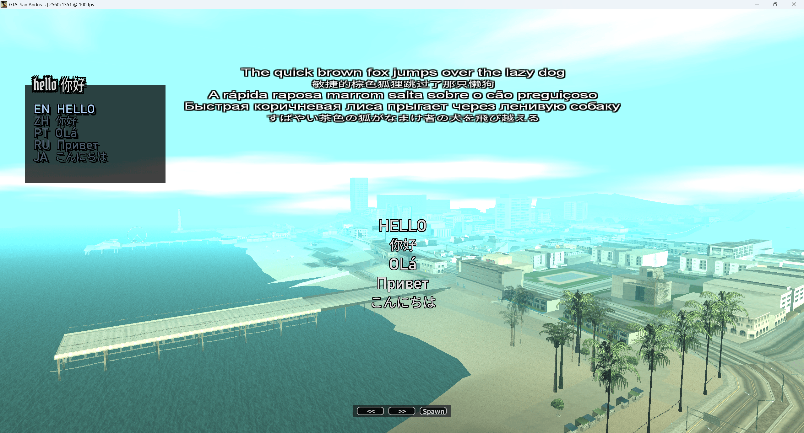

# samp-unicode

[English](README.md) | [简体中文](README.zh-CN.md) | [Português (BR)](README.pt-BR.md) | [Русский](README.ru-RU.md) | **日本語**

SA-MP 用のクライアントサイド MOD(`.asi`)です。**クライアントが描くテキスト全部**を実際の Unicode フォントで描き直します。
これにより、GBK、Big5、Shift-JIS、EUC-KR、キリル文字、UTF-8 など、どのエンコーディングで送られたサーバーテキストも、文字化けせずに読める形で表示されます。

「全部」は文字どおりです。`TextDraw`、`GameText`、ネイティブの `Menu` に加えて、クライアント自身が `ID3DXFont` で描くもの —— チャットボックスとその行、6 種類のダイアログ、TAB スコアボード、3D テキストラベル、ネームタグ、チャットバブル、デスウィンドウ、オブジェクトのマテリアルテキスト、ナンバープレート —— も対象です。
クライアント自身のデコード(システムの ANSI コードページ)はもうどの文字列も扱いません。バイト列はこの MOD が一度だけデコードし、グリフを持つフォントで描画します。

ゲーム自身のレイアウト、タイミング、色、可視性はそのまま維持され、変わるのはグリフだけです。
元の 4 つの `TextDrawFont` フェイスで描かれるラテン文字はそのフェイスを保ち、CJK は Unicode 表示フォントにフォールバックし、各画面はクライアントが要求したとおりの影を保ちます。
MOD が変えられないのは**入力する文字**です。チャット行とダイアログの入力欄は、クライアントが **システムの ANSI コードページ**の 1 バイト文字として読み戻すため、そのコードページに無い文字は送信時に失われます([制限事項](#制限事項)を参照)。



*右が TextDraw、左がネイティブメニュー、下が GameText。同じ 5 言語をすべて MOD が描画しています。*

## インストール

1. `samp-unicode.asi`(ブラックレター体を使いたい場合は `font0.ttf` も)を `GTA San Andreas\modloader\samp-unicode\` にコピーします。ASI ローダーが読み込む場所ならどこでもかまいません。
2. ゲームを一度起動します。`.asi` の隣に `samp-unicode.ini` と `samp-unicode.log` が生成されます。

## 互換性

この MOD はゲームが描画するテキストを置き換えるため、同じことをする別の MOD とそのテキストを共有することはできません。**テキスト置換系の MOD は一度に 1 つだけ動かしてください。**

| 競合するもの | 理由 |
|---|---|
| SA-MP 向けの他の中国語/キリル文字フォント MOD | どちらも `CTextDraw::Draw` / `CGame::DisplayGameText` / `CFont::PrintString` をフックし、どちらも元のテキストを空にします。最良の場合でも文字列がフォントごとに 1 回ずつ二重に描画され、最悪の場合は各 MOD が相手の描こうとしたものを空にするため、テキストが消えるか空白になります。 |
| `CGame::DisplayGameText` にもパッチを当てる "GameText fix" / `fixes.inc` 系のクライアントヘルパー | 同じ関数で、どちらも同じバイト列にパッチを当てます。通常は後から入れた方が勝ち、もう一方のトランポリンはパッチ済みのコードを指したまま残ります。 |
| D3D9 デバイスをプロキシオブジェクトで置き換える任意のオーバーレイ | この MOD は、vtable がヒープメモリ上にあるデバイスへのフックを拒否します(プロキシと競合してしまうため)。`proxy object, leaving it alone` とログに残して何もしない状態になり、ゲーム自身のビットマップテキストが表示され、問題は起きません。 |

併用できることも確認済みです(実際のインストール環境でテスト済み): modloader 本体、SilentPatch、`III.VC.SA.LimitAdjuster`、WidescreenFix、WindowedMode、FramerateVigilante、PreciseFramerateLimiter、SAMPGraphicRestore/ENB、および自前でテキストを描画しない CLEO スクリプト。

ログに `endpoint ... already hooked` と出る場合、または画面のすべての文字列が二重に表示される場合は、別の MOD が同じ箇所に入り込んでいます。その MOD を無効にして再起動してください。

## 設定

```ini
[font]
file =
family =
collection = 0
face =
font0 =
font1 =
font2 =
font3 =
size_divisor = 50
baseline_offset = 0
glyph_gamma = 1.00
antialias = on
outline_raster = off
shadow = on
letter_width = on
client_glyphs = on
shadow_offset = 1, 1

[textdraw]
fonts = 0, 1, 2, 3
brace_colors = off
scoreboard_layer = under

[menu]
enabled = on
font = 2
title_font = 0
title_scale = 1.00
title_dy = 0
title_width = 0.80
hscale = 1.00
align = 0
glyph = 1.0
outline = 1
shadow = 3
title_outline = 2
title_shadow = 0
shadow_color = 000000
shadow_alpha = 255
color = 0

[gametext]
enabled = on
fade_out = on
ignore_styles = none
scale = 0.82

[paths]
client_text = draw
client_text_font = 4
client_text_chat_font = 4
client_text_weight = 0
client_text_chat_shadow = 2
client_text_shadow_alpha = 255
client_text_drop_shadows = on
client_text_font_level = on
client_text_wrapper = on
client_text_wrapper_wide = on
client_text_ascii = ours
client_text_braces = on
client_text_tab = 4
client_text_line = 1.05
client_text_outline = auto

[encoding]
charset = auto
utf8_first = on
redraw_ascii = on
detect = on
single_byte = detect

[overlay]
hook_point = endscene

[debug]
log = on
verbose = off
```

| キー | 既定値 | 意味 |
|---|---|---|
| `font.file` / `font.family` | 空 | 表示フォント。サーバーの文字コードを担うフェイスです。`family` には CSS 風のリスト(`Noto Sans SC, Microsoft YaHei, sans-serif`)を指定できます。存在し、その文字コードをカバーする最初の項目が使われ、`sans-serif` / `system-ui` / `serif` も解釈されます。項目は CSS と同様に引用符で囲め(`"Source Han Sans SC"`)、名前の中にカンマを含められます。空 = `.asi` の隣の `samp-unicode.ttf`、次に組み込みの順序(YaHei、Noto Sans SC、Source Han Sans、PingFang、HarmonyOS Sans、MiSans、SimHei、SimSun、KaiTi、…)。 |
| `font.collection` | `0` | `.ttc` 内のインデックス。名前のないフェイスは自動的にスキップされます。 |
| `font.face` | 空 | 名前テーブルが使用できない `.ttc`(`simsun.ttc`)に対するファミリー名。空の場合はファイルから名前を読み取ります。 |
| `font.font0..3` | 空 | `TextDrawFont` 0–3 のフェイス。インストール済みのファミリー名、フォントファイル、または空 = MOD フォルダーの `fontN.ttf` / `samp-unicode-fontN.ttf`、それもなければ最も近いインストール済みフェイス。 |
| `font.size_divisor` | `50` | ピクセル高さ = `letter_height * screen_height / size_divisor`。50 = クライアントの 1 行 (20H) と同じ高さ。旧既定の 60 では全体が約 18% 小さくなります。文字がボックスからはみ出す場合は大きくしてください。 |
| `font.baseline_offset` | `0` | ピクセル単位の垂直方向の微調整。 |
| `font.shadow` / `font.shadow_offset` | `on` / `1, 1` | 任意のドロップシャドウ。オフセットはピクセル単位。 |
| `font.letter_width` | `on` | 各ランを、ゲームが `letterWidth` から確保した幅に引き伸ばします(サーバー側のアスペクト比を維持)。 |
| `font.client_glyphs` | `on` | 一部の句読点について、クライアント自身のフェイスが描く記号を描きます (face 2 の `]` は星、`[` は何も描きません)。`off` で通常の括弧のまま。 |
| `overlay.hook_point` | `endscene` | `endscene` は EndScene で描画するため、他のオーバーレイ（omp-client の F9 ウィンドウ、RTSS、ImGui MOD）が上に描かれます。これが既定値です: Present で描くと omp-client 自身のウィンドウを覆っていました。`present` はすべてのオーバーレイより上に描きます。 |
| `textdraw.fonts` | `0, 1, 2, 3` | 描き直すフォント ID。`4`/`5` はスプライトとモデルプレビューです。`all` = すべての ID。 |
| `textdraw.brace_colors` | `off` | `{RRGGBB}` / `{RRGGBBAA}` の波かっこも色変更として解釈します（クライアント自身は解釈しません）。 |
| `textdraw.scoreboard_layer` | `under` | `under` は GameText レイヤーをスコアボードの**手前** (パネルより先) に描画します。パネルは半透明なので、クライアント自身の GameText と同じように文字が透けて見えます。`hide` はパネルが開いている間は描画しません (パネルの描画をフックできない場合のフォールバック)。 |
| `menu.enabled` | `on` | Menu のテキスト(タイトル、列ヘッダー、行)を引き受けます。 |
| `menu.font` | `2` | メニューの行のフェイス。`0`–`3`、`[font]` を参照。 |
| `menu.hscale` | `1.00` | メニューテキストの水平方向の圧縮。GDI の送り幅はクライアント自身のメトリクスより少し広くなるため、`0.95`–`1.00` にすると高さを変えずに行幅を近づけられます。 |
| `menu.outline` / `menu.shadow` | `1` / `3` | 行のアウトラインとドロップシャドウ。どちらも 20 px の基準サイズで解釈され、拡大縮小されます。シャドウはアウトラインの*下*に描かれるため、アウトラインより大きい場合にだけ見えます。 |
| `menu.shadow_color` / `menu.shadow_alpha` | `000000` / `255` | シャドウの色(RRGGBB)とそのアルファ。`255` はゲームと同じ不透明な黒で、小さくするとより柔らかいシャドウになります。 |
| `menu.title_outline` / `menu.title_shadow` | `2` / `0` | タイトル用の同じ 2 項目。タイトルは行よりずっと大きく描かれます。 |
| `menu.title_scale` / `menu.title_dy` | `1.00` / `0` | タイトルだけに適用するサイズ倍率とピクセルオフセット。クライアントはタイトルを行より大きく描き、パネルの上端をまたがせます。 |
| `menu.title_width` | `0.80` | タイトルの字幅（行の字幅に対する比率）。クライアントのタイトルは字が細く字間が広いため代替フォントでは両立できず、0.80 はクライアントのタイトル幅（`hello` が 40 px 高で 71 px 幅）に合わせた値です。 |
| `menu.title_font` | `0` | メニュータイトルのフェイス。クライアントはタイトルをフェイス 0(`TextDrawFont 0` と同じもの)で描くため、それが既定値です。 |
| `menu.align` | `0` | ペンの配置。`0` = x からテキストを開始、`1` = 中央揃え、`2` = 右揃え。 |
| `menu.glyph` | `1.0` | メニューテキストのサイズ倍率(`1.0` = ゲーム自身が使うサイズ)。 |
| `menu.outline` | `2` | **20 px のグリフにおける**黒いアウトラインのピクセル数。タイトルはずっと大きく描かれるため、そのアウトラインはサイズに応じて拡大されます(40 px では 2 が 4 になります)。 |
| `menu.shadow` | `0` | 追加のドロップシャドウ(ピクセル)。 |
| `menu.color` | `0` | `RRGGBB` で 1 つの色に固定します。`0` = その行に対してゲームが設定した色を使います。 |
| `gametext.ignore_styles` | `none` | ゲーム自身のレンダラーに残すスタイル(`0`–`6`)。`none`/`all`。 |
| `gametext.enabled` | `on` | GameText を引き受けるかどうか。`off` にするとすべてのメッセージをクライアントに任せます。 |
| `gametext.scale` | `0.82` | 組み込みのスタイル別テキスト高さの倍率。0.82 はクライアント自身の GameText に合わせた実測値です (同じ解像度・同じスタイルで、行の高さがクライアント 45 px、1.0 のときの本 MOD は 55 px)。 |
| `gametext.fade_out` | `on` | 最後の約 400 ms をフェードさせます。オフにすると最大の明るさのままメッセージを切ります。 |
| `encoding.charset` | `auto` | `auto`、名前(`gbk`、`big5`、`sjis`、`euc-kr`、`cp1251`、`utf-8`、…)または数値。 |
| `encoding.utf8_first` | `on` | 文字コードより先に厳密な UTF-8 を試します。 |
| `encoding.redraw_ascii` | `on` | 純粋な ASCII テキストもこちらのレンダラーで描画します。既定で有効なので、すべての文字列が同じ書体・同じ大きさになり、ラテン文字と CJK が混ざる行の途中で字形が変わりません。`off` では英語だけの行をクライアント自身のビットマップフォントに任せます。 |
| `encoding.detect` | `on` | `auto` のとき、CJK/キリル文字の文字コードを検出します。UTF-8 とレガシーコードページの両方で有効なバイトペアは、レガシー CJK として扱われます。 |
| `debug.log` / `debug.verbose` | `on` / `off` | ログファイル出力の切り替えと、テクスチャーごとの詳細。 |

`auto` はプレイヤーの Windows ANSI コードページを意味します。そのため `detect = on` であれば、`欢迎来到服务器`(GBK)、`日本語のテスト`(Shift-JIS)、`Привет`(CP1251)はどのシステムでも正しくデコードされます。Latin-1 が再解釈されることはありません。

**自動判定は推測であり、明示したほうが確実です。** `charset = auto` はヒューリスティックで、
空白を含まない短い文字列は本質的に曖昧です(`D2 BB` は GBK の `一` でもあり、有効な UTF-8 の
文字でもあります)。どんな検出器でもすべてを当てることはできません。実際の運用ではサーバーは
1 つのエンコーディングで送るので、`charset = 936`(または `950`、`932`、`949`、`1251`) と
明示すれば MOD は推測しなくなります。混在は意図的に避けられます。サーバーはプレイヤーの
システムに入っていないエンコーディングで文章を送ることは普通しません。チャット、ダイアログ、
スコアボードは今もクライアント自身のデコード(システムのコードページ)を通るからです。

**設定は全体で 1 つだけで、短いテキストが一番の弱点です。** サーバーごとのプロファイルは
ありません。`samp-unicode.ini` は起動時に一度だけ読まれ、その後どのサーバーに接続しても
その設定が使われます。自動判定が最も弱いのは文字列が最短になる場所です。メニューの列見出しや
2 文字のラベルは、確信を持つにはバイト数が足りません。そのため言語の異なるサーバーを行き来する
プレイヤーは毎回 INI を書き換える必要があります。それはこの MOD が想定する使い方ではありません。

## ビルド

```bat
msbuild samp-unicode.vcxproj /nologo /p:Configuration=Release /p:Platform=Win32
```

または *x86 Native Tools Command Prompt* から `build.bat` を実行します。出力は `bin\Release\samp-unicode.asi` です。
CI(Actions → build → Run workflow)は Release をビルドし、`.asi`、生成された `.ini`、ライセンスをまとめた `samp-unicode-release.zip` をアップロードします。

## 仕組み

```
CTextDraw::Draw (text branch)  → collect text/position/size/colour, hide the
                                 game's glyphs, call the game function
CGame::DisplayGameText         → collect text/style/duration, feed spaces
CMenu::Show + display-list     → learn the menu title/rows and where they go
CFont::PrintString (menu text) → hide the line and draw it at the same pen
D3D9 Present (vtable)          → one textured quad per text run
D3D9 BeginScene (vtable)       → paste the background back on a frozen frame
```

オーバーレイは `Present` で描画するため、キャプチャーし、復元し、その上に描画するサーフェスは、実際に表示されているものになります。
これはメニューで重要です。メニューやポーズメニューが開いている間、クライアントはその領域の再描画を止めるため、そこからテキストを消す唯一の方法は背景を戻すことです。[既知の問題](#既知の問題)を参照してください。

テキストは `bytes → UTF-16 → GDI raster → D3D9 texture → quad` と流れるため、グリフは GTA の固定ビットマップフォントではなく、インストールされているフォントから得られます。
TextDraw はゲームのレイアウト、タイミング、可視性を保ち、GameText は以下のスタイル表に従って位置・時間・フェードが決まります。

- 色: 後述の[色](#色)を参照
- 長いテキスト: 1 枚の 4096x512 テクスチャーに収まらないランは、破棄されず切り詰められます
- 改行: `~n~` と実際の改行
- スプライト: フォント ID `4`/`5` は別のレンダラー(`CSprite2d`)を使うため、変更されません

### メニュー

`CMenu::Show` はパネルを構築するだけで、タイトル、ヘッダー、行は毎フレーム `CFont::PrintString` によって描画されます。そのため、画面の他の部分は正常なのにメニューだけ文字化けする、ということが起こります。
この MOD はその呼び出しをフックしますが、次の条件がすべて満たされる場合にだけ行を引き受けます。

- メニューが画面にある(`CMenu::Show` がここ数秒以内に実行され、そのテキストが描かれ続けている間は更新される)
- 文字列が純粋な ASCII ではない(英語の行はゲーム本来の見た目を保つ)
- その行がメニュー自身が使うフォント状態で描かれている。スコアボード、3D ラベル、チャットは別のサイズを使うため、そのまま通過します

### クライアントテキスト

クライアントは UI の文字を自前の `ID3DXFont` で、シングルバイト文字列として描きます。チャット、
スコアボード、各種ダイアログ、3D ラベル、ネームタグ、チャットバブル、死亡ウィンドウ、
オブジェクトのマテリアルテキスト、ナンバープレート - いずれも ANSI コードページに無い文字を
失います。`[paths] client_text = draw` はその描画を引き取り、本 MOD のフォントで描き直します。

**ランチャーが提供するすべてのビルド**（0.3.7-R1〜R5 と 0.3.DL）で動作します。特定のビルドの
アドレスには依存しません。3 つのシグネチャは `.text` 内で照合し、wrapper の vtable は
**検索**して見つけ（`.rdata` の 18 スロット表で、スロット 14 が `cmp eax, 0x186A0` を持つ関数を
指すもの）、影か本文かは**呼び出しの形**で判断します（黒 4 回 + 本文、5 回目が本文）。

パネル内の文字は記録し、パネルの描画が終わってから描きます（クライアントは文字の後に半透明の
塗りを重ねるため）。`CDXUTDialog::OnRender` は sprite バッチを開いたまま描くので、入口ではなく
呼び出し地点をリダイレクトします。テクスチャへ描く文字はバッチが閉じた後に描きます。

`\t` が 2 列を意味するのは `TABLIST` と `TABLIST_HEADERS` だけです。他の 4 スタイルでは
`client_text_tab` 個の空白に展開します（`DT_EXPANDTABS` と同じ）。

フック点、7 ビルドでの実測オフセット、試して駄目だった方法は `src/hooks.cpp` の該当コードのそばに書いてあります。

## コードページが混在するサーバー

入力方向は変わりません。本 mod の有無にかかわらず、プレイヤーが送るのはその Windows の ANSI
コードページのバイト列で（原版と同じ）、サーバーは常にそのコードページでデコードします。
出力方向だけが異なります。原版クライアントには同じコードページでエンコードし、本 mod を入れて
いるプレイヤーには UTF-8 をそのまま送ります —— デコード不要で、短い文字列では単バイト判定が
当てにならないという問題も避けられます。

## GameText スタイル

標準のクライアントには 3 つの癖がハードコードされており、[open.mp](https://open.mp/docs/scripting/resources/gametextstyles) では *fixes.inc / GameText+ で修正済み* とされています。

| スタイル | 標準クライアント | 本 MOD |
|---|---|---|
| 0 | 常に 9 秒で、他のすべての TextDraw と GameText を空にする | 要求された時間。それ以外は何も変更されない |
| 1 | 8 秒後にフェードアウトし、時間が終わるまでループする | 要求された時間だけ 1 回表示される |
| 5 | 常に 3 秒で、到着が速すぎるメッセージを破棄する | 要求された時間。レート制限なし |

レイアウト(位置、サイズ、色、配置、アウトライン)は、これらの修正が textdraw から組み立てるものに合わせています。
そのため、サーバーが fixes.inc / GameText+ を使っていても、生の GameText を送っていても、メッセージは同じ見た目になります。`time = 0` は「置き換えられるまで」を意味します。
スタイル 7–15 はこれらのインクルードだけが定義する GTA の HUD スタイルなので、その番号を使った生の呼び出しは今までどおりゲームのレンダラーに渡されます。

ゲームのポーズメニューが開いている間はメッセージが隠され、タイマーはゲーム自身のメッセージと同じようにそこで停止し、再開します。
Menu(`/menu`)ではどちらも行われません。メッセージは描画され続け、予定どおりフェードアウトし続けるため、メニューを開いても表示時間は変わりません。

## フォント

元のレンダラーには `TextDrawFont` 用の 4 つのフェイスがあり、すべての GameText スタイルはいずれかを選びます。

| id | 元のフェイス | GameText スタイル | インストール済みの代替 |
|---|---|---|---|
| 0 | ブラックレター | 2 | Old English Text MT、Blackadder ITC、… なければ Times New Roman |
| 1 | 太字サンセリフ | — | Arial |
| 2 | 幅広の大文字(Bank Gothic) | 3, 4, 5 | Bahnschrift |
| 3 | Pricedown | 0, 1, 6 | Impact |

リリースの zip には Pirata One(OFL、`THIRD_PARTY_NOTICES.md` を参照)が `font0.ttf` として同梱されているため、何もインストールしなくても id 0 と GameText スタイル 2 はブラックレターの見た目を保ちます。代替フェイスに戻すには、そのファイルを削除してください。

`font.family` は CSS 風のスタックを受け付けます(`family = Noto Sans SC, Microsoft YaHei, sans-serif`)。
項目は順に試され、存在してサーバーの文字コードをカバーする最初のフェイスが使われます。`sans-serif` / `system-ui` と `serif` は組み込みの順序に展開されます(serif は SimSun と Noto Serif SC で始まります)。管理下にないマシンで良い CJK フェイスを指定するための、移植性のある方法です。

組み込みの順序は `src/font.cpp` 内の 1 つのテーブルです。各項目は対応するスクリプトを明示しており、有効なコードページのスクリプトがどの項目を候補にするかを決めます。

| コードページ | 先頭の項目 |
|---|---|
| 932 日本語 | Yu Gothic、Meiryo、MS Gothic |
| 949 韓国語 | Malgun Gothic、Gulim |
| 950 繁体字 | Microsoft JhengHei、MingLiU |
| 936 簡体字 / 65001 | Noto Sans SC、Noto Sans CJK SC、Source Han Sans SC/CN、**Microsoft YaHei**、YaHei UI、PingFang SC、Hiragino Sans GB、HarmonyOS Sans SC、MiSans、WenQuanYi Micro Hei、SimHei、DengXian |

セリフ体(SimSun、NSimSun、KaiTi、Noto Serif SC、Songti SC、…)は同じテーブルに `serif` フラグ付きで入っており、ラテン文字のベース(Arial、Tahoma、Segoe UI、…)は CJK の項目の後に続き、カバレッジのフォールバックは Arial Unicode MS です。
スクリプトが合わないフェイスは、誤った字形で使われるのではなくスキップされます。日本語のページを簡体字の字形で描画するのは、スタイルの選択ではなくレンダリングのバグです。

**2 つのレイヤー。** `font.file` / `font.family` は表示フォントで、サーバーの文字コード(CJK)を担う必要があるものです。`font0..font3` は元のレンダラーの 4 つのラテンフェイスです。
各文字はその TextDrawFont ID のフェイスで描画され、そのフェイスにグリフがない場合(4 つのフェイスはラテン専用なので、すべての CJK 文字が該当します)は、代わりに表示フォントが描画します。
つまりラテン文字、数字、記号は `font0..3` から、CJK は常に `file`/`family` から来ます。1 行の中で、`SAMP` は Pricedown、你好 は表示フォント、という混在も可能です。

`font0..font3` は次の順序でフェイスを選びます。

1. INI の値 — `font1 = Arial`(インストール済みのファミリー)または `font2 = C:\Fonts\BankGothic.ttf`(ファイル。インストール不要。相対パスはまず `.asi` の隣、次にゲームフォルダーで検索されます)
2. `.asi` の隣の `font0.ttf` … `font3.ttf`(または `samp-unicode-font0.ttf` …)
3. 上記のテーブルから最も近いインストール済みフェイス

空は「未設定」を意味するため、4 つとも空のままにするとインストールされているものが使われます。TextDrawFont 2 は元のフェイスに小文字のグリフがないため、大文字で描画されます。

## 検証済み

TextDraw、GameText、2 つのメニューフックは、**0.3.7-R1** と **0.3.DL-1** で実行時に確認済みです。シグネチャは、パッチを 1 つも当てずに次でも一致します。

- 0.3.7-R2, 0.3.7-R3-0, 0.3.7-R3-1, 0.3.7-R4, 0.3.7-R5-1
- 0.3.DL-1

この MOD はバージョン番号やハードコードされたアドレスを読むのではなく、バイト列の照合でビルドを識別します。
そのため、このリストにないビルドも、同じシグネチャに一致するか、まったく変更されないかのどちらかです。ログには何が見つかり何がスキップされたかが記録されます。

## 色

3 つの異なる構文があり、これらは**互換ではありません**。

**スクリプト関数**(`TextDrawColor`、`TextDrawBoxColor`、`SendClientMessage`、…)は `0xRRGGBBAA` を取ります。赤、緑、青、その後にアルファで、[open.mp の色一覧](https://open.mp/docs/scripting/resources/colorslist)に記載されているとおりです。
したがって `0xFF0000FF` は不透明な赤、`0xFF000080` は半透明の赤、`0xFF000000` はアルファ 0 の赤、つまり見えません。ここで `0xAARRGGBB` と書くのが典型的な間違いです。`0xFF000000` が黒のように見え、`0x8000FF00` のボックスは黙って消えます。

**TextDraw と GameText の文字列内**では、クライアントは数値ではなく GameText の色スラッグを使います。

| コード | 色 | 備考 |
|---|---|---|
| `~r~ ~g~ ~b~ ~p~ ~y~` | 赤、緑、青、紫、黄 | スラッグの後に `~h~` を置くと 1 段階明るくなります。クライアントが許容する段階は 5/4/3/2/2 です |
| `~w~` / `~s~` | 白 | 同じ色の 2 つの表記 |
| `~l~` | グレー | 明るくできません |
| `~h~` | 明るくする | その前にある色に適用されます |

色以外のコード: `~n~` 改行、`~u~ ~d~ ~<~ ~>~` 灰色の矢印 (クライアント自身のテクスチャを使用、読めない場合のみ Unicode の矢印)、`~]~` **何も描画しません** (実機の GameText で確認済み。ドキュメントの星印は実機と異なります)、`~k~~KEY~` キーバインド。これらはすべてクライアントと同じ方法で解析され、その後オーバーレイによって描画されます。

**チャット、ダイアログ、3D ラベル**はこの MOD では変更されませんが、参考までに、これらはクライアントの埋め込み構文 `{RRGGBB}` を使います。16 進 6 桁で、**アルファなし**、`0x` 接頭辞もありません。

`{...}` はクライアントの TextDraw や GameText の構文の一部では**ありません**。open.mp は色の埋め込みが「textdraw では動作しない」と明言しているため、標準のクライアントは波かっこを書かれたとおりに描画します。
この MOD は既定でそれに従います。`{FF0000}` を含む TextDraw は、クライアントとまったく同じくリテラルなテキストとして表示されます。次のように設定すると

```ini
[textdraw]
brace_colors = on
```

パーサーが拡張として有効になり、さらに 8 桁の `{RRGGBBAA}` 形式(他のすべての SA-MP の色と同じ順序)も受け付けます。

`[menu] color` はアルファなしの `RRGGBB` です。オーバーレイが `FF` を自分で付けるため、`color = FF8800` は不透明なオレンジになります。

## 既知の問題

**アニメーションする TextDraw は位置がずれます。** TextDraw の文字は `[font] font0..font3`
の代替フォントで組むため字幅が可変ですが、クライアント自身の TextDraw フォントは**固定幅の
ビットマップフォント**です。文字を空白に入れ替えて動かす演出 (流れるサイト名、タイプライター
風のタイトル) は各文字の固定幅を前提にしているため、代替フォントでは文字が重なったり離れたり
します。元の字幅は復元できないので、そのフォント id を `[textdraw] fonts` から外す
(例: `fonts = 1, 2, 3`) か、対応する `fontN` に等幅フォントを指定してください。

**メニューとポーズメニューは、テキストを残さなくなりました。** 以前のビルドでは残っていました。Menu(`/menu`)やポーズメニューを開いている間、クライアントはその領域の再描画を止めるため、期限切れのメッセージが最後のピクセルを残していました。フェードアウトはさらに悪化させます。ブレンドはピクセルを背景に近づけることしかできず、元に戻すことはできないからです。

オーバーレイは `Present` で描画され、描画対象の矩形の 1 フレーム分のコピーを保持するため、どちらのケースも処理できます。

- **ライブフレーム** - ゲームがその領域を再描画するため、オーバーレイは描画を止めるだけでテキストは消えます。何も貼り戻しません。
- **凍結フレーム**(ポーズメニュー、ネイティブ Menu) - `BeginScene` で、クライアントが描画する前に保存された背景がまず塗り戻されるため、メニューが 1 フレームでも覆われることはありません。代わりに `Present` で復元すると、古い背景をメニューの上に貼ることになります。`/gt` の後に `/menu` を実行したときに見えていたちらつきがこれです。

実際には次のようになります。

- メニューを開いている間も GameText は予定どおり期限切れになり、メニューと一緒に閉じます
- ポーズメニューはテキストを隠し、タイマーを停止します(残りの時間は再開後に進みます)。クライアントと同じ動作です
- メッセージを置き換えると(`/gt 0` の後に `/gt 1`)、古いメッセージは即座に削除されます。クライアントと同じく GameText のスロットは 1 つだけです
- ライブフレームには一切手を触れないため、メッセージの置き換え時やフェード後に何もちらつきません

**クライアントの present 経路が別のオーバーレイによって迂回されている場合**、コピーは取得されず、古い挙動(領域が再描画されるまでテキストが残る)が現れることがあります。`debug.verbose = on` にするとこれが報告されます。`bg: valid=1` はコピーが機能していることを意味し、`background copy failed (...)` は理由を示します。
- **3 回に 1 回程度、起動直後にクライアントが勝手に終了します**。MOD がまだ何もフックしていない段階で、エラーダイアログも出ません。Windows のイベントログは毎回同じ箇所（`samp.dll_unloaded`、オフセット `0xFFF7D`、`0xC0000005`）を指し、この記録は MOD 導入前から存在するため、描画処理が原因ではありません。`REVIEW.md` では `B20` として記録しています。

## 知っておく価値のあるクライアントの癖

**クライアントの 4 つのフェイスは句読点を置き換えます。** 各フェイスは独自の字形テーブルを持ち、ASCII 句読点の一部は文字そのものではなくテーブルの記号領域を指します。1 行のプローブで実測した両極端は次のとおりです（`[ ] { } | \ ^ _ ` @ # $ & * ( ) < > ? / : ; , . = + - A Z a z 0 9`）。

| 送信 | font 0 の描画 | font 1 の描画 |
|---|---|---|
| `[` `]` | 星、`?` | `[` `]` |
| `(` `)` | `<` `>` | `(` `)` |
| `{` `}` | 小さい四角、`\` | `P` `§` |
| `*` | `[` | 小さい四角 |
| 英字、数字 | 変化なし | 変化なし |

これはフォント配置の性質で、パーサーの機能ではありません。**本 MOD は意図的に再現しません**: サーバーが送った文字をそのまま描くので、`[` はどのフェイスでも `[` です。再現すると、読める句読点をわざと別の句読点に変えることになります（`(A)` が `<A>` になる）。`~]~` は別の話で、そのコードは何も描きません。

- 空の、または空白だけの `TextDraw` はまったく描画されません。ボックスすら描画されないため、サーバーは「ボックス付きの空テキスト」をマスクとして使えません。
- スクリプト API の色は `0xRRGGBBAA` です。`0x00000000` は見えず、`0x000000AA` は 67% の黒です。
- `TextDrawTextSize` は、テキストフォントではボックスの右下の**角**、スプライトとプレビューのフォントでは幅/高さです。ボックスの原点は `TextDrawCreate` の位置から上に 10、左に 5 ユニットの地点です。

## 制限事項

- `gta_sa.exe` 1.0 のみ(D3D デバイスポインターと、それが読むポーズフラグは 1.0 のレイアウトです)。
- 絵文字は正しくデコードされますが、GDI はモノクロで描画します。
- **入力した文字は送信時に 1 バイトのままです。** チャット行とダイアログの `INPUT`/`PASSWORD` 欄は、クライアント自身の `CDXUTIMEEditBox` です。IME の変換は効きますし、欄の中はワイド文字で保持され、MOD がその中身を描画します。しかしクライアントは `GetText()` で読み戻し、それが返すのは**システムの ANSI コードページ**の `char*` です(`CInput::ProcessInput` とダイアログの応答はどちらもそこから `strncpy` します)。そのコードページに無い文字は、サーバーに届く前にこの時点で失われます。サーバーから返ってきた内容は、他のテキストと同じように MOD がデコードして描画します。

## ライセンス

MIT。同梱の文字コード検出器は Apache-2.0 です。[THIRD_PARTY_NOTICES.md](THIRD_PARTY_NOTICES.md) を参照してください。