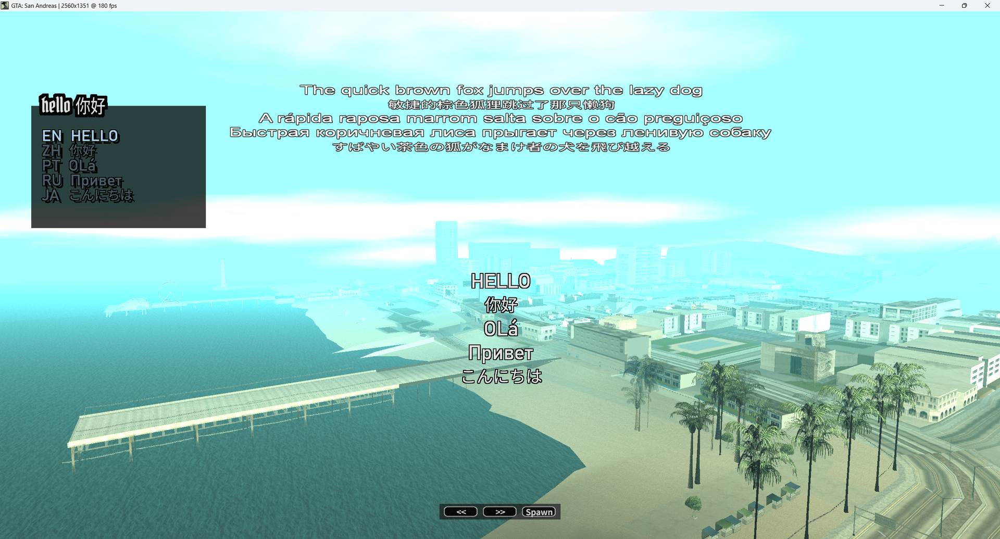

# samp-unicode

[简体中文](README.zh-CN.md) | [Português (BR)](README.pt-BR.md) | [Русский](README.ru-RU.md) | [日本語](README.ja-JP.md) | **English**

A client-side mod (an `.asi`) for SA-MP that draws **the client's text** with a real Unicode
font, so server text in any encoding — GBK, Big5, Shift-JIS, EUC-KR, Cyrillic, UTF-8 — shows
up readable instead of mojibake.

"All of it" is meant literally: `TextDraw`, `GameText` and the native `Menu` *and* everything
the client itself paints with `ID3DXFont` — the chat box and its lines, every dialog style,
the TAB scoreboard, 3D text labels, nametags, chat bubbles, the death window, object material
text and the license plate ([Client text](#client-text)). The client's own decoding (the
system ANSI code page) never sees a string: the bytes are decoded once by this mod and drawn
from a font that has the glyphs.

The game keeps its own layout, timing, colour and visibility; only the glyphs change. Latin
text drawn with the four original `TextDrawFont` faces keeps those faces, CJK falls back to a
Unicode display font, and each surface keeps the shadow the client itself asked for. The one
thing the mod cannot change is what is typed: the chat line and the dialog input field are
read back by the client as single bytes in the **system ANSI code page**, so a character that
page cannot hold is lost on submit ([Limitations](#limitations)).

The scoreboard still decides two things for the overlay, both matched to the client: while
its panel is open the TextDraw layer is dropped (the client skips its whole textdraw pass
there) and the GameText layer is drawn *behind* the translucent panel
([Scoreboard](#scoreboard)).



*TextDraw on the right, the native menu on the left, GameText along the bottom - the same five languages, drawn by the mod.*

## Install

1. Copy `samp-unicode.asi` (and, if you want the blackletter face,
   `font0.ttf`) into `GTA San Andreas\modloader\samp-unicode\` — or anywhere
   else the ASI loader picks up.
2. Start the game once. `samp-unicode.ini` and `samp-unicode.log` appear next to
   the `.asi`.

## Compatibility

This mod replaces the text the game draws, so it cannot share that text with
another mod that does the same. **Run one text-replacing mod at a time.**

| Conflicts | Why |
|---|---|
| Other Chinese/Cyrillic font mods for SA-MP | Both hook `CTextDraw::Draw` / `CGame::DisplayGameText` / `CFont::PrintString` and both blank the source text. At best the strings are drawn twice (once per font), at worst each mod blanks what the other wanted to draw, so text vanishes or turns into spaces. |
| "GameText fix" / `fixes.inc` client helpers that also patch `CGame::DisplayGameText` | Same function, both patch the same bytes. Whichever installs second usually wins and the other's trampoline is left pointing at patched code. |
| Any overlay that replaces the D3D9 device with a proxy object | The mod refuses to hook a device whose vtable lives in heap memory (it would fight the proxy). It logs `proxy object, leaving it alone` and becomes a no-op: the game's own bitmap text shows, nothing breaks. |

Known to work alongside (tested on a real install): modloader itself, SilentPatch,
`III.VC.SA.LimitAdjuster`, WidescreenFix, WindowedMode, FramerateVigilante,
PreciseFramerateLimiter, SAMPGraphicRestore/ENB, and CLEO scripts that do not draw
text themselves.

If the log says `endpoint ... already hooked` or the screen shows every string
twice, another mod is in the same place: disable it and restart.

## Configuration

A fresh `samp-unicode.ini` is written next to the `.asi` on first start; every key
below is in it and every key is optional (a missing key keeps its default).

```ini
[font]
file =
family =
collection = 0
face =
font0 =
font1 =
font2 =
font3 =
size_divisor = 50
baseline_offset = 0
glyph_gamma = 1.00
antialias = on
outline_raster = off
shadow = on
letter_width = on
client_glyphs = on
shadow_offset = 1, 1

[textdraw]
fonts = 0, 1, 2, 3
brace_colors = off
scoreboard_layer = under

[menu]
enabled = on
font = 2
title_font = 0
title_scale = 1.00
title_dy = 0
title_width = 0.80
hscale = 1.00
align = 0
glyph = 1.0
outline = 1
shadow = 3
title_outline = 2
title_shadow = 0
shadow_color = 000000
shadow_alpha = 255
color = 0

[gametext]
enabled = on
fade_out = on
ignore_styles = none
scale = 0.82

[paths]
client_text = draw
client_text_font = 4
client_text_chat_font = 4
client_text_weight = 0
client_text_chat_shadow = 2
client_text_shadow_alpha = 255
client_text_drop_shadows = on
client_text_font_level = on
client_text_wrapper = on
client_text_wrapper_wide = on
client_text_ascii = ours
client_text_braces = on
client_text_tab = 4
client_text_line = 1.05
client_text_outline = auto

[encoding]
charset = auto
utf8_first = on
redraw_ascii = on
detect = on
single_byte = detect

[overlay]
hook_point = endscene

[debug]
log = on
verbose = off
```

| Key | Default | Meaning |
|---|---|---|
| `font.file` / `font.family` | empty | Display font: the face that carries the station charset. `family` takes a CSS-like list (`Noto Sans SC, Microsoft YaHei, sans-serif`); the first entry that exists and covers the charset wins, and `sans-serif` / `system-ui` / `serif` are understood. Entries may be quoted like in CSS (`"Source Han Sans SC"`), which also allows a comma inside a name. Empty = `samp-unicode.ttf` next to the .asi, then the built-in order (YaHei, Noto Sans SC, Source Han Sans, PingFang, HarmonyOS Sans, MiSans, SimHei, SimSun, KaiTi, …). |
| `font.collection` | `0` | Index inside a `.ttc`. Faces without a name are skipped automatically. |
| `font.face` | empty | Family name for a `.ttc` whose name table is unusable (`simsun.ttc`); when empty the name is read from the file. |
| `font.font0` … `font.font3` | empty | Face for `TextDrawFont` 0-3: an installed family name, a font file, or empty = `fontN.ttf` / `samp-unicode-fontN.ttf` from the mod folder, else the closest installed face. |
| `font.size_divisor` | `50` | Pixel height = `letter_height * screen_height / size_divisor`. 50 makes one line as tall as the client's own 20H cell (measured against the stock renderer: 48 is the exact cell and 50 compensates for our slightly taller ink); raise it if the text looks too large on a page, lower it if a page looks too small. |
| `font.baseline_offset` | `0` | Vertical nudge in pixels. |
| `font.glyph_gamma` | `1.00` | Maps GDI's coverage before it becomes the glyph's alpha. Below `1` the middle coverage rises, so a stroke keeps its weight while its edge tightens; `1.00` leaves GDI's coverage untouched. Applies where the glyph texture is built, so every surface shares it. |
| `font.shadow` / `font.shadow_offset` | `on` / `1, 1` | Optional drop shadow, offset in pixels. |
| `font.letter_width` | `on` | Stretch each run to the width the game reserved from `letterWidth` (keeps the server's aspect ratio). |
| `font.client_glyphs` | `on` | Draw the symbol the client's own face draws for a few punctuation characters instead of the character itself: face 2 shows a star for `]` and nothing for `[`. `off` keeps plain brackets. |
| `overlay.hook_point` | `endscene` | `endscene` draws at EndScene, so other overlays (omp-client's F9 window, RTSS, ImGui mods) are drawn above us. That is the default: at Present this overlay painted over omp-client's own window. `present` puts us above every other overlay. |
| `textdraw.fonts` | `0, 1, 2, 3` | Font ids to re-render; `4`/`5` are sprite and model preview. `all` = every id. |
| `textdraw.brace_colors` | `off` | Also read `{RRGGBB}` / `{RRGGBBAA}` braces as colour changes. The client itself does not, so this only makes sense for a server that prints them on purpose (chat syntax). |
| `textdraw.scoreboard_layer` | `under` | `under` draws the GameText and native-menu layers before the scoreboard panel, so the panel covers them (the text shows through its translucency, the menu sits below it) and — because the panel is translucent — the text shows through it like the client's own. `hide` skips the layer while the panel is open, which is the fallback when the panel's draw cannot be hooked. |
| `menu.enabled` | `on` | Take over Menu text (title, column headers, rows). |
| `menu.font` | `2` | Face for menu rows: `0`-`3`, see `[font]`. |
| `menu.title_font` | `0` | Face for the menu title. The client draws the title with face 0 (the same one `TextDrawFont 0` uses), so that is the default. |
| `menu.title_scale` / `menu.title_dy` | `1.00` / `0` | Size multiplier and pixel offset for the title only. The client draws the title with the tall face and lets it straddle the panel's top edge. |
| `menu.title_width` | `0.80` | Glyph width of the title relative to a row glyph. The client's title face is narrow but tracked wide; a substitute face cannot match both, so this is calibrated for the width the client gives the title (`hello` = 71 px at 40 px tall). Lower it for narrower letters, raise it for wider. |
| `menu.hscale` | `1.00` | Horizontal squeeze for menu rows. GDI advances run slightly wider than the client's own metrics; `0.95`-`1.00` brings the line width closer without changing the height. |
| `menu.align` | `0` | Pen alignment: `0` = text starts at x, `1` = centred, `2` = right. |
| `menu.glyph` | `1.0` | Size multiplier for menu text (`1.0` = the size the game itself uses). |
| `menu.outline` / `menu.shadow` | `1` / `3` | Rows: outline and drop shadow, both in pixels at a 20-px reference size and scaled with the text. The shadow is drawn under the outline, so it only shows where it is wider. |
| `menu.title_outline` / `menu.title_shadow` | `2` / `0` | The same two for the title, which is drawn much larger than the rows (2 becomes 4 px at 40 px tall). |
| `menu.shadow_color` / `menu.shadow_alpha` | `000000` / `255` | Shadow colour (RRGGBB) and its alpha. `255` is opaque black like the game; lower it for a softer shadow. |
| `menu.color` | `0` | `RRGGBB` to force one colour, `0` = use the colour the game set for that line. |
| `gametext.enabled` | `on` | Take over GameText at all. `off` leaves every message to the client. |
| `gametext.ignore_styles` | `none` | Styles kept on the game's own renderer (`0`-`6`); `none` / `all`. |
| `gametext.scale` | `0.82` | Multiplier for the built-in per-style text height. `0.82` is measured against the client's own GameText: its cap height is 45 px where this renderer produced 55 at `1.0` on the same style and screen. |
| `gametext.fade_out` | `on` | Fade the last ~400 ms. Off cuts the message at full brightness. |
| `encoding.charset` | `auto` | `auto`, a name (`gbk`, `big5`, `sjis`, `euc-kr`, `cp1251`, `utf-8`, …) or a number. |
| `encoding.utf8_first` | `on` | Try strict UTF-8 before the charset. |
| `encoding.detect` | `on` | With `auto`, detect CJK/Cyrillic encodings. A byte pair that is valid in both UTF-8 and the legacy codepage is taken as legacy CJK. |
| `encoding.redraw_ascii` | `on` | Draw pure-ASCII text with our renderer as well. On is the default, so one face and one size covers every string and a line that mixes Latin and CJK does not change shape halfway through. `off` leaves English-only lines to the client's own bitmap font. |
| `debug.log` / `debug.verbose` | `on` / `off` | Log file switch and per-texture detail. |

`auto` means the player's Windows ANSI code page, so `欢迎来到服务器` (GBK),
`日本語のテスト` (Shift-JIS) or `Привет` (CP1251) are decoded correctly on any
system once `detect = on`; Latin-1 is never reinterpreted.

The `[paths]` block that decides **which surfaces are taken over** — `client_text = off |
log | draw`, the face and width of that text, how thick its shadow is and whether the
client's own shadow passes are dropped — is documented key by key under [Configuration](#configuration).

**Detection is a guess, and a named encoding beats it.** `charset = auto` is a
heuristic: a short string without spaces is genuinely ambiguous (`D2 BB` is both GBK
`一` and a valid UTF-8 character), and no detector resolves every case. In practice a
server sends everything in one encoding, so name it - `charset = 936` (or `950`, `932`,
`949`, `1251`) - and the mod stops guessing. Every surface that shows text is decoded here,
so the ANSI code page only matters to what the client submits from its own edit boxes.

**One global configuration, and short text is the weak spot.** There are no
per-server profiles: `samp-unicode.ini` is read once at start and applies to whatever
server the player joins next. Detection is weakest exactly where the strings are
shortest - a menu column header or a two-character label carries too few bytes to be
certain - so a player who alternates between servers in different languages would have
to edit the INI each time. That is not a workflow this mod tries to support.

## Build

```bat
msbuild samp-unicode.vcxproj /nologo /p:Configuration=Release /p:Platform=Win32
```

or `build.bat` from an *x86 Native Tools Command Prompt*. Output:
`bin\Release\samp-unicode.asi`. CI (Actions → build → Run workflow) builds
Release and uploads `samp-unicode-release.zip` with the `.asi`, the generated
`.ini` and the licences.

`test.pwn` in this directory is the probe gamemode the screenshots were taken with
(`/lang`, `/tda`, `/menu2`, `/td`, …). Build it with the server's own compiler and
copy the result next to `omp-server.exe`:

```bat
qawno\pawncc.exe test.pwn -i<server>\qawno\include -;+ -(+ -o test.amx
```

## How it works

```
CTextDraw::Draw (text branch)  → collect text/position/size/colour, hide the
                                 game's glyphs, call the game function
CGame::DisplayGameText         → collect text/style/duration, feed spaces
CMenu::Show + display-list     → learn the menu title/rows and where they go
CFont::PrintString (menu text) → hide the line and draw it at the same pen
ID3DXFont::DrawTextA/W         → the client's own text: chat, labels, dialogs,
                                 scoreboard, nametags, death window. Drop its
                                 shadow copies, remember the pairing
CFontWrapper vtable            → the same lines one level lower (DXUT text,
                                 buttons, rows, chat) - decoded and redrawn
CDXUTDialog::OnRender sites    → queue that panel's text for after its fill
D3D9 Present (vtable)          → one textured quad per text run
D3D9 BeginScene (vtable)       → paste the background back on a frozen frame
```

The overlay draws at `Present`, so the surface it captures, restores and draws on is
the one that is shown. That matters for menus: the client stops repainting the area
while a menu or the pause menu is up, and the only way to remove text there is to put
the background back - see [Known issues](#known-issues).

Text goes `bytes → UTF-16 → GDI raster → D3D9 texture → quad`, so the glyphs
come from the installed font instead of GTA's fixed bitmap font. TextDraws keep
the game's layout, timing and visibility; GameText is placed, timed and faded
from the style table below.

- colours: see [Colours](#colours) below
- long text: a run that does not fit one 4096x512 texture is truncated, not dropped
- line breaks: `~n~` and real newlines
- sprites: font ids `4`/`5` use another renderer (`CSprite2d`) and are untouched

### Menu

`CMenu::Show` only builds the panel; the title, headers and rows are drawn every
frame by `CFont::PrintString`, which is why a menu shows mojibake while the rest
of the screen is fine. The mod hooks that call, but only takes a line over when
all of these hold:

- a menu is on screen (`CMenu::Show` ran within the last few seconds, refreshed
  while its text keeps being drawn);
- the string is not pure ASCII (English rows keep the game's own look);
- the line was drawn with the font state the menu itself uses — the scoreboard,
  3D labels and chat use different sizes and pass straight through.

The title is the odd one out: the client draws it with the tall face and a
non-square scale, so it is 40 px tall and 71 px wide for `hello` where the rows'
face would give half that height. `src/hooks.cpp` matches the height through its
own base and the width through `[menu] title_width`, both measured against the
client on a real menu.

### Scoreboard

The client draws its scoreboard after the HUD pass, so its own GameText ends up
*under* the panel. The overlay runs at `Present`, i.e. after everything, which
would paint GameText on top of the list instead. The panel's own draw is therefore
hooked: the GameText layer is drawn first and the panel over it, so with the
panel's translucency the text is visible through it exactly as the client's is,
and the message keeps its clock. When that hook cannot be installed (a build
without the expected prologue) the layer is skipped instead - the message is
queued, its clock runs, and it is gone or shorter when the panel closes, which is
what `scoreboard_layer = hide` asks for explicitly. TextDraws are a different story: the client skips its whole textdraw pass while the panel is open - the loop that calls the textdraw renderer is guarded by `cmp [CScoreboard], 0; jne` right in front of it - so the overlay drops the TextDraw layer too instead of painting it over the panel. The native menu is a third layer: the client keeps drawing it, so the overlay paints it below the panel as well, above the GameText, exactly where the client has it.

The panel's own "shown" flag decides that, not a key: in this client TAB is a
toggle (press to open, press again or ESC to close), so a key check would be wrong
in both directions. The flag is found from the structure around the panel's draw
call, never from a fixed address (see [Verified](#verified)). If it cannot be
located, the layer simply stays over the panel as before, which the log reports.


### Client text

The client draws its own interface text with `ID3DXFont`, in single-byte strings: the chat,
the scoreboard, every dialog style, the 3D labels, the nametags, the chat bubbles, the death
window, the object material text and the license plate. Every one of them loses text the
ANSI code page cannot represent. `[paths] client_text = draw` takes those draws over and
paints them with this mod's font, so a server's Chinese chat, names, dialogs and signs
appear as typed.

The whole set works on **every build the launcher offers** (0.3.7-R1 through R5 and
0.3.DL), not just 0.3.DL:

| Surface | Reached through |
| --- | --- |
| 3D labels, nametags, chat bubbles, scoreboard header, dialog body, download window title | `CFonts::DrawText` / `DrawLittleText` |
| Chat lines, buttons, table rows, statics | the `CFontWrapper` vtable |
| Dialog body again, so it lands above the panel fill | `CDialog::Draw` |
| Spawn screen buttons, server dialog, download window list | the direct call sites of `CDXUTDialog::OnRender` |
| Death window names | the font level, by the shape of the calls |
| Object material text, license plate | the font level and the wrapper, drawn into the texture |

Nothing is keyed on one build's addresses. The three signatures are matched in `.text`; the
wrapper vtable is *searched for* (an eighteen slot table in `.rdata` whose slot 14 carries
the client's own `cmp eax, 0x186A0` length guard), which is how the chat and the buttons are
reached on 0.3.7 as well; and the shadow/body decision uses the call shapes instead of
addresses - four black passes then the body, so the fifth call is the body even when it is
black.

Each panel's text is recorded while that panel draws and painted once its draw has
returned, because the client paints the translucent fill *after* the text it produced inside
it. `CDXUTDialog::OnRender` is the awkward one: it draws inside an open sprite batch, so its
entry point is left alone and its call sites are redirected to a stub that runs it first and
paints afterwards.

Text that renders into a texture is drawn after the sprite batch closes, which is the only
moment where the texture is still the target and the batch is not open.

A tab only means two columns in `TABLIST` and `TABLIST_HEADERS`; there the client splits the
line itself and draws every cell at its own position. In the other four styles a tab is
expanded to `client_text_tab` spaces, which is what `DT_EXPANDTABS` does anyway.

The hook points, the offsets measured on each client build, and the approaches that were tried
and do not work are described in `src/hooks.cpp`, next to the code they affect.

## Servers with mixed code pages

Input is unaffected: with or without this mod a player sends the bytes of their Windows ANSI code
page, exactly like the stock client, so the server always decodes with that page.
Output differs: for a stock client encode in that same page; for a player running this mod send UTF-8
as-is - no decoding, and none of the guesswork that makes single-byte detection unreliable on short
strings.

## GameText styles

The stock client hard-codes three quirks that [open.mp](https://open.mp/docs/scripting/resources/gametextstyles)
marks as *fixed in fixes.inc / GameText+*:

| Style | Stock client | Here |
|---|---|---|
| 0 | always 9 s, blanks every other TextDraw and GameText | the requested time, nothing else is touched |
| 1 | fades out after 8 s and loops until the time ends | shown once, for the requested time |
| 5 | always 3 s, drops messages that arrive too fast | the requested time, no rate limit |

The layouts (position, size, colour, alignment, outline) are the ones those
fixes build from textdraws, so a message looks the same whether the server uses
fixes.inc / GameText+ or sends raw GameText. `time = 0` means "until replaced".
Styles 7–15 are GTA HUD styles that only those includes define, so a raw call
with one of those numbers still goes to the game's renderer.

A message is hidden while the game's pause menu is up, and its timer freezes and
resumes there like the game's own messages. Menu (`/menu`) does neither:
the message keeps being drawn and keeps fading out on schedule, so opening a menu
never changes how long it lasts.

## Fonts

The original renderer has four faces for `TextDrawFont`, and every GameText style
picks one of them:

| id | original face | GameText styles | installed substitute |
|---|---|---|---|
| 0 | blackletter | 2 | Old English Text MT, Blackadder ITC, … else Times New Roman |
| 1 | bold sans | — | Arial |
| 2 | wide capitals (Bank Gothic) | 3, 4, 5 | Bahnschrift |
| 3 | Pricedown | 0, 1, 6 | Impact |

The release zip ships Pirata One (OFL, see `THIRD_PARTY_NOTICES.md`) as
`font0.ttf`, so id 0 and GameText style 2 keep the blackletter look without
installing anything; delete that file to fall back to the substituted face.

`font.family` accepts a CSS-like stack: `family = Noto Sans SC, Microsoft YaHei,
sans-serif`. Entries are tried in order and the first face that exists and covers
the station charset is used; `sans-serif` / `system-ui` and `serif` expand to the
built-in orders (the serif one starts with SimSun and Noto Serif SC). This is the
portable way to ask for a good CJK face on machines you do not control.

The built-in order is one table in `src/font.cpp`: every entry names the scripts it
serves, and the script of the active code page decides which entries are eligible at
all.

| code page | first entries |
|---|---|
| 932 Japanese | Yu Gothic, Meiryo, MS Gothic |
| 949 Korean | Malgun Gothic, Gulim |
| 950 Traditional | Microsoft JhengHei, MingLiU |
| 936 Simplified / 65001 | Noto Sans SC, Noto Sans CJK SC, Source Han Sans SC/CN, **Microsoft YaHei**, YaHei UI, PingFang SC, Hiragino Sans GB, HarmonyOS Sans SC, MiSans, WenQuanYi Micro Hei, SimHei, DengXian |

Serif faces (SimSun, NSimSun, KaiTi, Noto Serif SC, Songti SC, …) live in the same
table behind a `serif` flag, the Latin base (Arial, Tahoma, Segoe UI, …) comes after
the CJK entries, and Arial Unicode MS is the coverage fallback. A face from the wrong
script is skipped instead of being used with wrong glyph shapes: a Japanese page
rendered with simplified Chinese forms is a rendering bug, not a style choice.

**Two layers.** `font.file` / `font.family` is the display font: the one that has
to carry the station charset (CJK). `font0..font3` are the four Latin faces of the
original renderer. Each character is drawn with the face of its TextDrawFont id,
and when that face has no glyph for it — every CJK character, because the four
faces are Latin-only — the display font draws it instead. So Latin, digits and
symbols come from `font0..3`, CJK always comes from `file`/`family`; a line can
mix `SAMP` in Pricedown with 你好 in the display font.

`font0..font3` pick a face, in this order:

1. the INI value — `font1 = Arial` (an installed family) or
   `font2 = C:\Fonts\BankGothic.ttf` (a file, no install needed; a relative path is searched next to the .asi first, then in the game folder);
2. `font0.ttf` … `font3.ttf` (or `samp-unicode-font0.ttf` …) next to the .asi;
3. the closest installed face from the table above.

Empty means "not set", so leaving all four alone uses whatever is installed.
TextDrawFont 2 is rendered in capitals because the original face has no
lowercase glyphs.

## Verified

TextDraw, GameText and both menu hooks were checked at runtime on **0.3.7-R1** and
**0.3.DL-1**. Every lookup was then re-checked against all seven builds that ship
with the open.mp launcher (0.3.7-R1, R2, R3, R3-1, R4, R5 and 0.3.DL), by running
the same search over each binary:

| what | how it is found | result |
|---|---|---|
| `CTextDraw::Draw` dispatch thunk | 19-byte signature | found in all seven |
| CTextDraw field offsets (text, colours, size, flags, font, position, sprite slot) | read out of each build's text renderer | all 16 offsets in all seven |
| `CGame::DisplayGameText` | 10-byte prologue | found in all seven |
| `CMenu::Show`, menu encoder | 12- and 32-byte signatures | found in all seven |
| scoreboard flag | draw prologue, then the relative call to it, then the `cmp [reg],0` in front of that call | found in all seven |
| `~k~` key expander | gta_sa.exe prologue (no client address at all) | one address for every client |

The mod identifies a build by matching bytes, not by reading a version number or a
hard-coded address, so a build that is not in this list either matches the same
signatures or stays untouched - the log names what was found and what was skipped.

The runtime lookups were confirmed in the log of a normal session on **0.3.DL**
(`scoreboard: flag at samp.dll+0x2AC9DC`) and on **0.3.7-R1**
(`+0x21A0B4`), so the scoreboard layering and the menu layer below the
panel are exercised on two of the seven builds:

```
scoreboard: flag at samp.dll+0x2AC9DC, the panel is read from it
scoreboard: draw hooked, the GameText layer goes under the panel
symbols: client textures at raster+0x34 (32x32 32x32 32x32 32x32)
~k~ expander: gta_sa rva 0x29E160
overlay: hook_point=endscene, client_glyphs=on
```

Every lookup that reads the client at runtime degrades quietly: the arrows fall
back to `U+2191..2193` when the sprite textures cannot be read, the GameText layer
stays over the scoreboard when the flag cannot be located, and `~k~` shows the
action name literally when the expander is not found.


## Layer order

The overlay draws at `Present` by default, i.e. after everything the game has
drawn, so it sits above the world, the HUD, the client's TextDraws and GameText,
the menus and the scoreboard panel. That also means it sits above anything another
mod draws inside the frame, and above every overlay that hooks `Present` - among
Present hooks the one that draws last wins, and the chain order is decided by load
order.

Two exceptions, both deliberate:

- the scoreboard panel, see above (GameText behind it, TextDraws dropped);
- `[overlay] hook_point = endscene`, which draws at `EndScene` instead. `EndScene`
  runs before every `Present` detour, so overlays such as omp-client's ImGui
  settings window (F9), RTSS or another ImGui mod are drawn above ours. It is off
  by default because `EndScene` does not guarantee the back buffer is the bound
  render target.

## Colours

Three different syntaxes are in play and they are **not** interchangeable.

**Scripting functions** (`TextDrawColor`, `TextDrawBoxColor`, `SendClientMessage`,
…) take `0xRRGGBBAA` — red, green, blue, then alpha, as documented in the
[open.mp colour list](https://open.mp/docs/scripting/resources/colorslist). So
`0xFF0000FF` is opaque red, `0xFF000080` is half-transparent red and `0xFF000000`
is red with alpha 0, i.e. invisible. Writing `0xAARRGGBB` here is the classic
mistake: `0xFF000000` then looks like black, and a box with `0x8000FF00` silently
disappears.

**Inside TextDraw and GameText strings** the client uses the GameText colour
slugs, not numbers:

| Code | Colour | Notes |
|---|---|---|
| `~r~` | `B4191D` dark red | |
| `~g~` | `36682C` dark green | |
| `~b~` | `323C7F` dark blue | |
| `~p~` | `A86EFC` purple | |
| `~y~` | `E2C063` tan | |
| `~w~` / `~s~` | `E1E1E1` light grey | same colour, two spellings; not pure white |
| `~l~` | `000000` black | `~h~` on black stays black |
| `~h~` | lighten | each one multiplies every channel by 1.5 and clamps at 255 |

The colours are not guesses: they were read out of `gta_sa.exe` at `0xBAB22C`, the
palette the client's own text renderer indexes, and confirmed by drawing a
`/tdcodes` page and measuring it. That `~l~` is **black** rather than grey is one of
the things the measurement settled.

`~h~` is not an approximation either. The client scales the current colour by 1.5
once per code (`CFont::ParseToken`, `gta_sa.exe+0x718F00`), so repeated `~h~`
compound and truncate after every step: red's green channel goes
25 -> 37 -> 55 -> 82 -> 123 -> 184. Five steps up on red is `FFB8D8`, which is
exactly what the `/tdlight` screenshot measured, `(221, 159, 187)`, once the
client's 221/255 output scale is applied. The "5 levels for red, 1 for white"
lists in the GameText documentation are where each colour runs out of headroom,
not a cap the renderer enforces.

Non-colour codes: `~n~` line break, `~u~ ~d~ ~<~ ~>~` the four grey arrows,
`~k~~KEY~` a key binding. A line break does not reset the colour: the client keeps
it and replays the last colour code at the start of the following line, so text
after a trailing `~h~` comes out one step lighter again.

The arrows are not glyphs. The client draws `ButtonSprite[1..4]`, four 32x32
textures it loads from `MODELS\PCBTNS.TXD`, in a square of 17H by 17H set 2H
below the pen (`CFont::PrintChar`). The overlay reads those same four textures out
of `CFont::ButtonSprite` (`gta_sa+0xC71AD8`) and draws the same square with a
white vertex colour and the text alpha, so the arrows are the client's own bitmap
rather than a lookalike; the advance follows the square and ignores
`TextDrawLetterSize`, exactly like the client. If the textures cannot be read it
falls back to `U+2191..U+2193` and logs it once.

`~]~` draws nothing. The GameText reference says it prints an asterisk in styles
3, 4 and 5, but the client's font parser has no case for the character and a
captured vanilla GameText style 3 renders `star ~]~ end` as `STAR END`, so the
token is dropped like every other unknown code.

`~k~~PED_FIREWEAPON~` is not reimplemented: samp.dll does not expand it either, it
forwards to `gta_sa.exe`, which looks the control name up and prints the label of the
**current** binding. The overlay calls that same function (reached through the
`samp.dll+0x9FD90` thunk), so the label follows a rebind exactly like the stock client,
down to the mouse buttons reading `LMB`/`RMB`.

The client has one hard rule here: **k-codes only work in short strings**. It counts
the characters between tildes and, above 24, replaces the whole TextDraw with
`Error: can't use k-codes in long string`; an unpaired tilde gives
`Error: unmatched tilde`. That check runs in samp.dll when the string is set, before
this mod sees it, so a long string arrives already replaced - nothing to reproduce.

**Chat, dialogs and 3D labels** are not touched by this mod, but for reference they
use the client's embedding syntax `{RRGGBB}` — six hex digits, **no alpha**, no
`0x` prefix.

`{...}` is **not** part of the client's TextDraw or GameText syntax: open.mp says
plainly that colour embedding "does not work in textdraws", so the stock client
draws the braces as written. This mod follows that by default — a TextDraw
containing `{FF0000}` shows the literal text, exactly like the client. Setting

```ini
[textdraw]
brace_colors = on
```

turns the parser on as an extension and additionally accepts the eight-digit
`{RRGGBBAA}` form (same order as every other SA-MP colour).

`[menu] color` is `RRGGBB` without alpha — the overlay adds `FF` itself, so
`color = FF8800` is opaque orange.

## Known issues

**Menus and the pause menu no longer leave text behind.** Older builds did: with a
Menu (`/menu`) or the pause menu open the client stops repainting the area, so a
message that expired kept its last pixels - and a fade-out made it worse, because
blending can only move pixels towards the background, never restore it.

The overlay is drawn at `Present` and keeps a one-frame copy of the rectangle it
draws on, so both cases are handled:

- **live frame** - the game repaints the area, so the overlay just stops drawing and
  the text is gone. Nothing is pasted back.
- **frozen frame** (pause menu, native Menu) - the stored background is painted back
  first, in `BeginScene` and before the client draws, so the menu is never covered
  for a frame. Restoring at `Present` instead would paste the old background over the
  menu - the flash that `/gt` followed by `/menu` used to show.

What this means in practice:

- a GameText expires on schedule while a menu is open, and closes with it;
- the pause menu hides the text and freezes its timer (the rest of the time plays
  after resuming), like the client;
- replacing a message (`/gt 0` then `/gt 1`) removes the old one immediately - there
  is one GameText slot, as in the client;
- a live frame is never touched, which is why nothing flashes when a message is
  replaced or after its fade.

**If the client's present path is bypassed by another overlay** the copy is never
taken and the older behaviour (text that stays until the area is repainted) can
still show up. `debug.verbose = on` reports it: `bg: valid=1` means the copy works,
`background copy failed (...)` names the reason.

**Two deltas from the stock renderer are deliberate.** Punctuation that the
client's font tables substitute is drawn as the character that was sent, except the
one measured star entry (see the quirk above). The four arrows are
drawn at 0.85 of the text height where the client's own ratio works out near 0.95,
so they are about a tenth smaller than the client's - the smaller one reads better
next to a GameText line. And the code-heavy measurement below is a stretch
estimate. The first two come from `SplitRunIntoPieces` / `SymbolSizePx` in
`src/common.h`, the stretch from `WidthScale` in `src/hooks.cpp`.

A line whose text is mostly colour codes used to come out up to 22% wider than the
client's, because the horizontal fit counted one cell per source byte; it now
counts the drawn glyphs, which leaves a residual of roughly +/-10% from the
substitute font's own advances.

**Another overlay can be covered.** With the default `hook_point = present` the
overlay is painted after every other `Present` overlay, so it can cover their UI.
omp-client (0.4.0) is the one case seen so far: its F9 settings window is Dear ImGui
1.90.8 drawn from a hook on SA-MP's own `SAMPD3DPresent`, which runs inside the
frame. Set `[overlay] hook_point = endscene` to draw before those instead, and note
that the mod does not touch omp-client's memory either way - the setting only moves
where the overlay draws.

**If a page overflows its box**, raise `font.size_divisor` in the ini: 50 makes one
line as tall as the client's own cell, 55 shrinks everything by about a tenth, and
60 (the old default) by a sixth.

- **About one launch in three the client closes itself right after starting**, before the mod has installed anything and with no crash dialog. The Windows event log always names the same site (`samp.dll_unloaded`, offset `0xFFF7D`, `0xC0000005`), and that entry also appears on launches from before this mod was involved, so it is not caused by the redraw work. Tracked as `B20` in `REVIEW.md`.


## Quirks of the client worth knowing

**The client's four faces remap punctuation.** Each face has its own glyph
table, and a block of ASCII punctuation points into the symbol section of that
table instead of the character itself. Measured with one probe line per face
(`[ ] { } | \ ^ _ ` @ # $ & * ( ) < > ? / : ; , . = + - A Z a z 0 9`), the two
extremes are:

| sent | face 0 draws | face 1 draws |
|---|---|---|
| `[` `]` | a star, then `?` | `[` `]` |
| `(` `)` | `<` `>` | `(` `)` |
| `{` `}` | a small box, then `\` | `P` `§` |
| `*` | `[` | a small box |
| letters, digits | unchanged | unchanged |

This is a font-layout quirk, not a parser feature. The mod reproduces exactly one
entry of it, the star: face 2 draws `]` as a star and nothing at all for `[`, and
with `font.client_glyphs = on` (the default) the overlay draws that same symbol, so
`[GBK]` reads the way the client draws it. The rest of the table is left alone on
purpose - reproducing it would turn readable punctuation into different punctuation
(`(A)` would come out as `<A>` in face 0). `~]~` is unrelated: that code draws
nothing at all, see the code table above.

**Other client behaviour the mod has to live with:**

- An empty or whitespace-only `TextDraw` is not drawn at all — not even its box —
  so a server cannot use "empty text with a box" as a mask.
- Colours in the scripting API are `0xRRGGBBAA`: `0x00000000` is invisible,
  `0x000000AA` is black at 67%.
- `TextDrawTextSize` is the box's bottom-right **corner** for the text fonts and
  a width/height for the sprite and preview fonts; the box origin is 10 units up
  and 5 to the left of the `TextDrawCreate` position.

## Limitations

- `gta_sa.exe` 1.0 only: the D3D device pointer, the pause flags, the arrow sprites
  (`CFont::ButtonSprite`) and the `~k~` expander are all read at 1.0 addresses. On
  another executable those lookups simply fail and their fallbacks apply.
- Emoji decode correctly but GDI renders them monochrome.
- **Typed text is still single-byte when it is submitted.** The chat line and the dialog
  `INPUT`/`PASSWORD` field are the client's own `CDXUTIMEEditBox` controls: IME composition
  works, the box holds the characters as wide text, and the mod draws that text — but the
  client reads it back with `GetText()`, which returns a `char*` in the **system ANSI code
  page** (`CInput::ProcessInput` and the dialog's reply both `strncpy` from it). A character
  the code page cannot represent is lost at that point, before any server sees it. The
  answer that comes back is decoded and drawn by the mod like any other text.

## License

MIT. The vendored charset detector is Apache-2.0; see
[THIRD_PARTY_NOTICES.md](THIRD_PARTY_NOTICES.md).