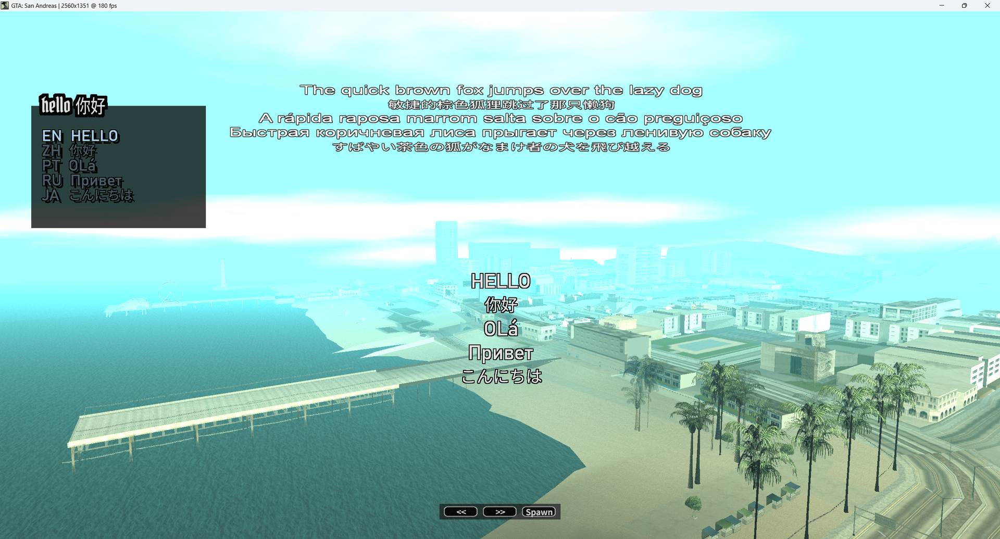

# samp-unicode

[English](README.md) | [简体中文](README.zh-CN.md) | [Русский](README.ru-RU.md) | [日本語](README.ja-JP.md) | **Português (BR)**

Um mod do lado do cliente (um `.asi`) para SA-MP que desenha **todo o texto do cliente** com
uma fonte Unicode de verdade, para que o texto do servidor em qualquer codificação — GBK,
Big5, Shift-JIS, EUC-KR, cirílico, UTF-8 — apareça legível em vez de virar mojibake.

"Todo" é literal: `TextDraw`, `GameText` e o `Menu` nativo *e* tudo o que o próprio cliente
pinta com `ID3DXFont` — a caixa de chat e suas linhas, todos os estilos de diálogo, o placar
do TAB, os rótulos de texto 3D, as placas de nome, as bolhas de chat, a janela de mortes, o
texto de material de objeto e a placa do veículo. A decodificação do próprio cliente (a
página de código ANSI do sistema) não vê mais nenhuma string: os bytes são decodificados uma
vez por este mod e desenhados de uma fonte que tem os glifos.

O jogo mantém o próprio layout, timing, cor e visibilidade; só os glifos mudam. O texto
latino desenhado com as quatro faces originais de `TextDrawFont` mantém essas faces; CJK cai
para uma fonte Unicode de exibição, e cada superfície mantém a sombra que o cliente pediu.
O que o mod não muda é o que é **digitado**: a linha de chat e o campo de input do diálogo
são lidos de volta pelo cliente como bytes na **página de código ANSI do sistema**, então um
caractere que essa página não contém se perde no envio (veja
[Limitações](#limitações)).



*TextDraw à direita, o menu nativo à esquerda e o GameText na parte inferior - os mesmos cinco idiomas, desenhados pelo mod.*

## Instalação

1. Copie `samp-unicode.asi` (e, se você quiser a face blackletter,
   `font0.ttf`) para `GTA San Andreas\modloader\samp-unicode\` — ou para qualquer
   outro lugar onde o loader de ASI procure.
2. Inicie o jogo uma vez. `samp-unicode.ini` e `samp-unicode.log` aparecem ao lado
   do `.asi`.

## Compatibilidade

Este mod substitui o texto que o jogo desenha, então não pode compartilhar esse texto com
outro mod que faça a mesma coisa. **Execute um mod de substituição de texto por vez.**

| Conflitos | Motivo |
|---|---|
| Outros mods de fonte chinesa/cirílica para SA-MP | Ambos fazem hook de `CTextDraw::Draw` / `CGame::DisplayGameText` / `CFont::PrintString` e ambos apagam o texto de origem. Na melhor das hipóteses as strings são desenhadas duas vezes (uma por fonte); na pior, cada mod apaga o que o outro queria desenhar, então o texto some ou vira espaços. |
| Auxiliares de cliente "GameText fix" / `fixes.inc` que também aplicam patch em `CGame::DisplayGameText` | Mesma função, ambos aplicam patch nos mesmos bytes. Quem instala por segundo normalmente vence, e o trampoline do outro fica apontando para código já modificado. |
| Qualquer overlay que substitua o dispositivo D3D9 por um objeto proxy | O mod se recusa a fazer hook em um dispositivo cuja vtable fica na memória heap (ele brigaria com o proxy). Ele registra `proxy object, leaving it alone` e vira um no-op: o texto bitmap do próprio jogo aparece, nada quebra. |

Comprovadamente funciona junto (testado em uma instalação real): o próprio modloader, SilentPatch,
`III.VC.SA.LimitAdjuster`, WidescreenFix, WindowedMode, FramerateVigilante,
PreciseFramerateLimiter, SAMPGraphicRestore/ENB, e scripts CLEO que não desenham
texto por conta própria.

Se o log disser `endpoint ... already hooked` ou a tela mostrar cada string
duas vezes, outro mod está no mesmo lugar: desative-o e reinicie.

## Configuração

```ini
[font]
file =
family =
collection = 0
face =
font0 =
font1 =
font2 =
font3 =
size_divisor = 50
baseline_offset = 0
glyph_gamma = 1.00
antialias = on
outline_raster = off
shadow = on
letter_width = on
client_glyphs = on
shadow_offset = 1, 1

[textdraw]
fonts = 0, 1, 2, 3
brace_colors = off
scoreboard_layer = under

[menu]
enabled = on
font = 2
title_font = 0
title_scale = 1.00
title_dy = 0
title_width = 0.80
hscale = 1.00
align = 0
glyph = 1.0
outline = 1
shadow = 3
title_outline = 2
title_shadow = 0
shadow_color = 000000
shadow_alpha = 255
color = 0

[gametext]
enabled = on
fade_out = on
ignore_styles = none
scale = 0.82

[paths]
client_text = draw
client_text_font = 4
client_text_chat_font = 4
client_text_weight = 0
client_text_chat_shadow = 2
client_text_shadow_alpha = 255
client_text_drop_shadows = on
client_text_font_level = on
client_text_wrapper = on
client_text_wrapper_wide = on
client_text_ascii = ours
client_text_braces = on
client_text_tab = 4
client_text_line = 1.05
client_text_outline = auto

[encoding]
charset = auto
utf8_first = on
redraw_ascii = on
detect = on
single_byte = detect

[overlay]
hook_point = endscene

[debug]
log = on
verbose = off
```

| Chave | Padrão | Significado |
|---|---|---|
| `font.file` / `font.family` | vazio | Fonte de exibição: a face que carrega o charset da estação. `family` aceita uma lista no estilo CSS (`Noto Sans SC, Microsoft YaHei, sans-serif`); a primeira entrada que existir e cobrir o charset vence, e `sans-serif` / `system-ui` / `serif` são reconhecidos. As entradas podem vir entre aspas como no CSS (`"Source Han Sans SC"`), o que também permite uma vírgula dentro de um nome. Vazio = `samp-unicode.ttf` ao lado do .asi, depois a ordem interna (YaHei, Noto Sans SC, Source Han Sans, PingFang, HarmonyOS Sans, MiSans, SimHei, SimSun, KaiTi, …). |
| `font.collection` | `0` | Índice dentro de um `.ttc`. Faces sem nome são puladas automaticamente. |
| `font.face` | vazio | Nome de família para um `.ttc` cuja tabela de nomes está inutilizável (`simsun.ttc`); quando vazio, o nome é lido do arquivo. |
| `font.font0..3` | vazio | Face para `TextDrawFont` 0–3: um nome de família instalado, um arquivo de fonte, ou vazio = `fontN.ttf` / `samp-unicode-fontN.ttf` na pasta do mod, senão a face instalada mais próxima. |
| `font.size_divisor` | `50` | Altura em pixels = `letter_height * screen_height / size_divisor`. 50 deixa uma linha com a mesma altura da célula do cliente (20H); o antigo padrão 60 encolhia tudo em cerca de 18%. Aumente se o texto estourar a caixa. |
| `font.baseline_offset` | `0` | Ajuste vertical em pixels. |
| `font.shadow` / `font.shadow_offset` | `on` / `1, 1` | Sombra projetada opcional, deslocamento em pixels. |
| `font.letter_width` | `on` | Estica cada trecho até a largura que o jogo reservou a partir de `letterWidth` (mantém a proporção definida pelo servidor). |
| `font.client_glyphs` | `on` | Desenha o símbolo que a própria face do cliente desenha para alguns sinais: na face 2, `]` vira uma estrela e `[` não desenha nada. `off` mantém os colchetes normais. |
| `overlay.hook_point` | `endscene` | `endscene` desenha no EndScene, então outros overlays (janela F9 do omp-client, RTSS, mods ImGui) ficam acima de nós. Esse é o padrão: desenhando no Present este overlay cobria a própria janela do omp-client. `present` nos coloca acima de todos os outros overlays. |
| `textdraw.fonts` | `0, 1, 2, 3` | Ids de fonte a renderizar novamente; `4`/`5` são sprite e prévia de modelo. `all` = todos os ids. |
| `textdraw.brace_colors` | `off` | Também interpreta `{RRGGBB}` / `{RRGGBBAA}` como cor. O cliente não faz isso; só serve para servidores que imprimem essas chaves de propósito. |
| `textdraw.scoreboard_layer` | `under` | `under` desenha a camada de GameText **antes** do painel do placar; como o painel é translúcido, o texto aparece através dele, igual ao GameText do próprio cliente. `hide` não desenha enquanto o painel está aberto (é o fallback quando o desenho do painel não pode ser hookado). |
| `menu.enabled` | `on` | Assumir o texto do Menu (título, cabeçalhos de coluna, linhas). |
| `menu.font` | `2` | Face das linhas do menu: `0`–`3`, veja `[font]`. |
| `menu.hscale` | `1.00` | Compressão horizontal do texto do menu. Os avanços do GDI ficam um pouco mais largos que as métricas do próprio cliente; `0.95`–`1.00` aproxima a largura da linha sem mudar a altura. |
| `menu.outline` / `menu.shadow` | `1` / `3` | Linhas: contorno e sombra projetada, ambos lidos em um tamanho de referência de 20 px e escalados. A sombra é desenhada *embaixo* do contorno, então só aparece quando é maior que ele. |
| `menu.shadow_color` / `menu.shadow_alpha` | `000000` / `255` | Cor da sombra (RRGGBB) e seu alfa, para que a sombra possa ser mais suave que o contorno. |
| `menu.title_outline` / `menu.title_shadow` | `2` / `0` | Os mesmos dois para o título, que é desenhado bem maior que as linhas. |
| `menu.title_scale` / `menu.title_dy` | `1.00` / `0` | Multiplicador de tamanho e deslocamento em pixels apenas para o título. O cliente desenha o título maior que as linhas e deixa que ele ultrapasse a borda superior do painel. |
| `menu.title_width` | `0.80` | Largura do glifo do título em relação a um glifo de linha. A fonte do título do cliente é estreita mas com avanço largo, e uma fonte substituta não iguala os dois; 0.80 reproduz a largura do cliente (`hello` = 71 px com 40 px de altura). |
| `menu.title_font` | `0` | Face do título do menu. O cliente desenha o título com a face 0 (a mesma que `TextDrawFont 0` usa), por isso esse é o padrão. |
| `menu.align` | `0` | Alinhamento do texto: `0` = o texto começa em x, `1` = centralizado, `2` = à direita. |
| `menu.glyph` | `1.0` | Multiplicador de tamanho do texto do menu (`1.0` = o tamanho que o próprio jogo usa). |
| `menu.outline` | `2` | Contorno preto em pixels **num glifo de 20 px**; o título é desenhado bem maior, então o contorno dele escala com o tamanho (2 vira 4 a 40 px). |
| `menu.shadow` | `0` | Sombra projetada extra em pixels. |
| `menu.color` | `0` | `RRGGBB` para forçar uma cor, `0` = usar a cor que o jogo definiu para aquela linha. |
| `gametext.ignore_styles` | `none` | Estilos mantidos no renderizador do próprio jogo (`0`–`6`); `none`/`all`. |
| `gametext.enabled` | `on` | Assumir o GameText por completo. `off` deixa todas as mensagens para o cliente. |
| `gametext.scale` | `0.82` | Multiplicador da altura de texto interna por estilo. 0.82 foi medido contra o GameText do próprio cliente: 45 px de altura de linha no cliente contra 55 px aqui em 1.0, no mesmo estilo e resolução. |
| `gametext.fade_out` | `on` | Faz fade nos últimos ~400 ms. Desligado, corta a mensagem no brilho total. |
| `encoding.charset` | `auto` | `auto`, um nome (`gbk`, `big5`, `sjis`, `euc-kr`, `cp1251`, `utf-8`, …) ou um número. |
| `encoding.utf8_first` | `on` | Tenta UTF-8 estrito antes do charset. |
| `encoding.redraw_ascii` | `on` | Desenhar texto puramente ASCII com o nosso renderizador também. Ligado é o padrão: uma só face e um só tamanho para todas as strings, e uma linha que mistura latim e CJK não muda de forma no meio. `off` deixa as linhas só em inglês para a fonte bitmap do próprio cliente. |
| `encoding.detect` | `on` | Com `auto`, detecta codificações CJK/cirílicas. Um par de bytes válido tanto em UTF-8 quanto na codepage legada é considerado CJK legado. |
| `debug.log` / `debug.verbose` | `on` / `off` | Ativação do arquivo de log e detalhe por textura. |

`auto` significa a página de código ANSI do Windows do jogador, então `欢迎来到服务器` (GBK),
`日本語のテスト` (Shift-JIS) ou `Привет` (CP1251) são decodificados corretamente em qualquer
sistema com `detect = on`; Latin-1 nunca é reinterpretado.

**A detecção é um palpite, e um charset explícito é melhor.** `charset = auto` é uma
heurística: uma string curta sem espaços é genuinamente ambígua (`D2 BB` é tanto `一`
em GBK quanto um caractere UTF-8 válido), e nenhum detector acerta todos os casos. Na
prática um servidor envia tudo em uma única codificação, então declare-a —
`charset = 936` (ou `950`, `932`, `949`, `1251`) — e o mod para de adivinhar. Combinações
misturadas são raras de propósito: um servidor normalmente não envia texto em uma
codificação que os sistemas dos jogadores não têm instalada, porque o chat, os diálogos
e o placar continuam passando pela decodificação do próprio cliente, que é a code page
do sistema.

**Uma configuração global, e o texto curto é o ponto fraco.** Não existem perfis por
servidor: `samp-unicode.ini` é lido uma vez ao iniciar e vale para qualquer servidor que
o jogador entrar depois. A detecção é mais fraca exatamente onde as strings são mais
curtas — um cabeçalho de coluna de menu ou um rótulo de dois caracteres carrega bytes
de menos para ter certeza — então quem alterna entre servidores em idiomas diferentes
teria de editar o INI a cada vez. Esse não é um fluxo que este mod tente suportar.

## Compilação

```bat
msbuild samp-unicode.vcxproj /nologo /p:Configuration=Release /p:Platform=Win32
```

ou `build.bat` a partir de um *x86 Native Tools Command Prompt*. Saída:
`bin\Release\samp-unicode.asi`. A CI (Actions → build → Run workflow) compila em
Release e envia `samp-unicode-release.zip` com o `.asi`, o `.ini` gerado
e as licenças.

## Como funciona

```
CTextDraw::Draw (text branch)  → collect text/position/size/colour, hide the
                                 game's glyphs, call the game function
CGame::DisplayGameText         → collect text/style/duration, feed spaces
CMenu::Show + display-list     → learn the menu title/rows and where they go
CFont::PrintString (menu text) → hide the line and draw it at the same pen
D3D9 Present (vtable)          → one textured quad per text run
D3D9 BeginScene (vtable)       → paste the background back on a frozen frame
```

O overlay desenha em `Present`, então a superfície que ele captura, restaura e usa para
desenhar é a que está sendo mostrada. Isso importa para os menus: o cliente para de repintar
a área enquanto um menu ou o menu de pausa está aberto, e a única forma de remover o texto ali
é recolocar o fundo - veja [Problemas conhecidos](#problemas-conhecidos).

O texto percorre `bytes → UTF-16 → GDI raster → D3D9 texture → quad`, então os glifos
vêm da fonte instalada em vez da fonte bitmap fixa do GTA. Os TextDraws mantêm
o layout, o timing e a visibilidade do jogo; o GameText é posicionado, cronometrado e
esmaecido conforme a tabela de estilos abaixo.

- cores: veja [Cores](#cores) abaixo
- texto longo: um trecho que não cabe em uma textura 4096x512 é truncado, não descartado
- quebras de linha: `~n~` e novas linhas reais
- sprites: os ids de fonte `4`/`5` usam outro renderizador (`CSprite2d`) e não são tocados

### Menu

`CMenu::Show` só monta o painel; o título, os cabeçalhos e as linhas são desenhados a cada
frame por `CFont::PrintString`, e é por isso que um menu mostra mojibake enquanto o resto
da tela está normal. O mod faz hook nessa chamada, mas só assume uma linha quando todas
estas condições valem:

- há um menu na tela (`CMenu::Show` executou nos últimos segundos, renovado
  enquanto o texto dele continua sendo desenhado);
- a string não é ASCII puro (as linhas em inglês mantêm a aparência do próprio jogo);
- a linha foi desenhada com o estado de fonte que o próprio menu usa — o placar,
  os rótulos 3D e o chat usam tamanhos diferentes e passam direto.

## Servidores com code pages mistas

A entrada não muda: com ou sem este mod, o jogador envia os bytes da code page ANSI do Windows dele,
exatamente como no cliente original, então o servidor sempre decodifica com essa code page.
A saída muda: para um cliente original, codifique nessa mesma code page; para um jogador com este
mod, envie UTF-8 direto - sem decodificação e sem o palpite que torna a detecção de byte único
pouco confiável em textos curtos.

## Estilos de GameText

O cliente original embute três peculiaridades que o [open.mp](https://open.mp/docs/scripting/resources/gametextstyles)
marca como *corrigidas no fixes.inc / GameText+*:

| Estilo | Cliente original | Aqui |
|---|---|---|
| 0 | sempre 9 s, apaga todos os outros TextDraw e GameText | o tempo solicitado, nada mais é tocado |
| 1 | faz fade após 8 s e reinicia até o tempo acabar | mostrado uma vez, pelo tempo solicitado |
| 5 | sempre 3 s, descarta mensagens que chegam rápido demais | o tempo solicitado, sem limite de taxa |

Os layouts (posição, tamanho, cor, alinhamento, contorno) são os que essas
correções montam a partir de textdraws, então uma mensagem fica igual quer o servidor use
fixes.inc / GameText+ ou envie GameText bruto. `time = 0` significa "até ser substituída".
Os estilos 7–15 são estilos de HUD do GTA que só esses includes definem, então uma chamada
bruta com um desses números ainda vai para o renderizador do jogo.

Uma mensagem fica oculta enquanto o menu de pausa do jogo está aberto, e o timer dela
congela e retoma ali como as mensagens do próprio jogo. O Menu (`/menu`) não faz nem uma
coisa nem outra: a mensagem continua sendo desenhada e continua desaparecendo no prazo,
então abrir um menu nunca muda quanto tempo ela dura.

## Fontes

O renderizador original tem quatro faces para `TextDrawFont`, e todo estilo de GameText
escolhe uma delas:

| id | face original | estilos de GameText | substituta instalada |
|---|---|---|---|
| 0 | blackletter | 2 | Old English Text MT, Blackadder ITC, … senão Times New Roman |
| 1 | sans em negrito | — | Arial |
| 2 | capitulares largas (Bank Gothic) | 3, 4, 5 | Bahnschrift |
| 3 | Pricedown | 0, 1, 6 | Impact |

O zip de release inclui a Pirata One (OFL, veja `THIRD_PARTY_NOTICES.md`) como
`font0.ttf`, então o id 0 e o estilo 2 de GameText mantêm o visual blackletter sem
instalar nada; exclua esse arquivo para voltar à face substituta.

`font.family` aceita uma pilha no estilo CSS: `family = Noto Sans SC, Microsoft YaHei,
sans-serif`. As entradas são testadas em ordem e a primeira face que existe e cobre
o charset da estação é usada; `sans-serif` / `system-ui` e `serif` expandem para as
ordens internas (a de serif começa com SimSun e Noto Serif SC). Essa é a
forma portátil de pedir uma boa face CJK em máquinas que você não controla.

A ordem interna é uma única tabela em `src/font.cpp`: cada entrada nomeia os scripts que
atende, e o script da página de código ativa decide quais entradas são elegíveis.

| página de código | primeiras entradas |
|---|---|
| 932 japonês | Yu Gothic, Meiryo, MS Gothic |
| 949 coreano | Malgun Gothic, Gulim |
| 950 tradicional | Microsoft JhengHei, MingLiU |
| 936 simplificado / 65001 | Noto Sans SC, Noto Sans CJK SC, Source Han Sans SC/CN, **Microsoft YaHei**, YaHei UI, PingFang SC, Hiragino Sans GB, HarmonyOS Sans SC, MiSans, WenQuanYi Micro Hei, SimHei, DengXian |

As faces serif (SimSun, NSimSun, KaiTi, Noto Serif SC, Songti SC, …) ficam na mesma
tabela atrás de uma flag `serif`, a base latina (Arial, Tahoma, Segoe UI, …) vem depois
das entradas CJK, e Arial Unicode MS é o fallback de cobertura. Uma face do script
errado é pulada em vez de usada com formas de glifo erradas: uma página japonesa
renderizada com formas chinesas simplificadas é um bug de renderização, não uma escolha
de estilo.

**Duas camadas.** `font.file` / `font.family` é a fonte de exibição: a que precisa
carregar o charset da estação (CJK). `font0..font3` são as quatro faces latinas do
renderizador original. Cada caractere é desenhado com a face do id de TextDrawFont dele,
e quando essa face não tem glifo para ele — todo caractere CJK, porque as quatro
faces são só latinas — a fonte de exibição o desenha no lugar. Assim, latim, dígitos e
símbolos vêm de `font0..3`, CJK sempre vem de `file`/`family`; uma linha pode
misturar `SAMP` em Pricedown com 你好 na fonte de exibição.

`font0..font3` escolhem uma face, nesta ordem:

1. o valor no INI — `font1 = Arial` (uma família instalada) ou
   `font2 = C:\Fonts\BankGothic.ttf` (um arquivo, sem precisar instalar; um caminho relativo é procurado primeiro ao lado do .asi, depois na pasta do jogo);
2. `font0.ttf` … `font3.ttf` (ou `samp-unicode-font0.ttf` …) ao lado do .asi;
3. a face instalada mais próxima da tabela acima.

Vazio significa "não definido", então deixar as quatro em branco usa o que estiver
instalado. TextDrawFont 2 é renderizado em capitulares porque a face original não tem
glifos minúsculos.

## Verificado

TextDraw, GameText e os dois hooks de menu foram verificados em runtime no **0.3.7-R1** e
no **0.3.DL-1**. As assinaturas também batem, sem um único patch, em:

- 0.3.7-R2, 0.3.7-R3-0, 0.3.7-R3-1, 0.3.7-R4, 0.3.7-R5-1
- 0.3.DL-1

O mod identifica uma build comparando bytes, não lendo um número de versão nem um
endereço fixo no código, então uma build que não está nesta lista ou bate as mesmas
assinaturas ou fica intocada - o log informa o que foi encontrado e o que foi ignorado.

## Cores

Três sintaxes diferentes estão em jogo e elas **não** são intercambiáveis.

**Funções de scripting** (`TextDrawColor`, `TextDrawBoxColor`, `SendClientMessage`,
…) usam `0xRRGGBBAA` — vermelho, verde, azul e depois alfa, como documentado na
[lista de cores do open.mp](https://open.mp/docs/scripting/resources/colorslist). Então
`0xFF0000FF` é vermelho opaco, `0xFF000080` é vermelho semitransparente e `0xFF000000`
é vermelho com alfa 0, ou seja, invisível. Escrever `0xAARRGGBB` aqui é o erro
clássico: `0xFF000000` passa a parecer preto, e uma caixa com `0x8000FF00` some
silenciosamente.

**Dentro das strings de TextDraw e GameText** o cliente usa os slugs de cor do GameText,
não números:

| Código | Cor | Observações |
|---|---|---|
| `~r~ ~g~ ~b~ ~p~ ~y~` | vermelho, verde, azul, roxo, amarelo | `~h~` depois de um slug clareia um nível; o cliente permite 5/4/3/2/2 níveis |
| `~w~` / `~s~` | branco | a mesma cor, duas grafias |
| `~l~` | cinza | não pode ser clareado |
| `~h~` | clarear | aplica-se à cor que vem antes dele |

Códigos que não são de cor: `~n~` quebra de linha, `~u~ ~d~ ~<~ ~>~` setas cinzas (desenhadas com
as texturas do próprio cliente; se não puderem ser lidas, cai para as setas Unicode),
`~]~` **não desenha nada** (confirmado no cliente original; o asterisco da documentação não
acontece), `~k~~KEY~` uma tecla vinculada. Todos eles são interpretados
do mesmo jeito que o cliente faz e depois desenhados pelo overlay.

**Chat, diálogos e rótulos 3D** também são desenhados por este mod, e usam a sintaxe de
embutimento de cor do próprio cliente: `{RRGGBB}` — seis dígitos hexadecimais, **sem alfa**,
sem prefixo `0x`.

`{...}` **não** faz parte da sintaxe de TextDraw nem de GameText do cliente: o open.mp diz
claramente que o embutimento de cor "não funciona em textdraws", então o cliente original
desenha as chaves como estão escritas. Este mod segue isso por padrão — um TextDraw
contendo `{FF0000}` mostra o texto literal, exatamente como o cliente. Definir

```ini
[textdraw]
brace_colors = on
```

ativa o parser como uma extensão e ainda aceita a forma de oito dígitos
`{RRGGBBAA}` (mesma ordem de qualquer outra cor do SA-MP).

`[menu] color` é `RRGGBB` sem alfa — o overlay adiciona `FF` sozinho, então
`color = FF8800` é laranja opaco.

## Problemas conhecidos

**Menus e o menu de pausa não deixam mais texto para trás.** Builds antigas deixavam: com um
Menu (`/menu`) ou o menu de pausa aberto o cliente para de repintar a área, então uma
mensagem que expirava mantinha os últimos pixels - e o fade piorava a situação, porque
a mistura só consegue mover pixels na direção do fundo, nunca restaurá-lo.

O overlay é desenhado em `Present` e mantém uma cópia de um frame do retângulo sobre o qual
desenha, então os dois casos são tratados:

- **frame ao vivo** - o jogo repinta a área, então o overlay simplesmente para de desenhar e
  o texto some. Nada é recolado.
- **frame congelado** (menu de pausa, Menu nativo) - o fundo armazenado é repintado
  primeiro, em `BeginScene` e antes de o cliente desenhar, então o menu nunca fica coberto
  por um frame. Restaurar em `Present`, em vez disso, colaria o fundo antigo por cima do
  menu - o flash que `/gt` seguido de `/menu` costumava mostrar.

O que isso significa na prática:

- um GameText expira no prazo enquanto um menu está aberto e fecha junto com ele;
- o menu de pausa oculta o texto e congela seu timer (o restante do tempo corre
  depois de retomar), como o cliente;
- substituir uma mensagem (`/gt 0` e depois `/gt 1`) remove a antiga imediatamente - há
  um único slot de GameText, como no cliente;
- um frame ao vivo nunca é tocado, e é por isso que nada pisca quando uma mensagem é
  substituída ou depois do fade dela.

**Se o caminho de present do cliente for desviado por outro overlay** a cópia nunca é
feita e o comportamento antigo (texto que fica até a área ser repintada) ainda pode
aparecer. `debug.verbose = on` informa isso: `bg: valid=1` significa que a cópia funciona,
`background copy failed (...)` indica o motivo.
- **Em cerca de um lançamento a cada três o cliente fecha sozinho logo após iniciar**, antes de o mod instalar qualquer coisa e sem caixa de erro. O log de eventos do Windows aponta sempre o mesmo local (`samp.dll_unloaded`, offset `0xFFF7D`, `0xC0000005`), e essa entrada já aparecia em execuções anteriores a este mod, então não é causada pelo redesenho. Registrado como `B20` em `REVIEW.md`.

## Peculiaridades do cliente que vale a pena conhecer

**As quatro fontes do cliente remapeiam pontuação.** Cada face tem sua própria tabela de glifos, e um bloco de pontuação ASCII aponta para a seção de símbolos dessa tabela em vez do próprio caractere. Medido com uma linha de teste por face (`[ ] { } | \ ^ _ ` @ # $ & * ( ) < > ? / : ; , . = + - A Z a z 0 9`), os dois extremos são:

| enviado | face 0 desenha | face 1 desenha |
|---|---|---|
| `[` `]` | uma estrela, depois `?` | `[` `]` |
| `(` `)` | `<` `>` | `(` `)` |
| `{` `}` | um quadradinho, depois `\` | `P` `§` |
| `*` | `[` | um quadradinho |
| letras, dígitos | inalterados | inalterados |

É uma peculiaridade do leiaute da fonte, não do parser, e o mod **não** a reproduz de propósito: desenha os caracteres que o servidor mandou, então `[` continua `[` em qualquer face. Reproduzir significaria transformar pontuação legível em outra pontuação (`(A)` sairia como `<A>`). `~]~` é outra coisa: esse código não desenha nada.

- Um `TextDraw` vazio ou só com espaços não é desenhado de forma alguma — nem a caixa dele —
  então um servidor não pode usar "texto vazio com uma caixa" como máscara.
- As cores na API de scripting são `0xRRGGBBAA`: `0x00000000` é invisível,
  `0x000000AA` é preto a 67%.
- `TextDrawTextSize` é o **canto** inferior direito da caixa para as fontes de texto e
  uma largura/altura para as fontes de sprite e de prévia; a origem da caixa fica 10 unidades
  acima e 5 à esquerda da posição de `TextDrawCreate`.

## Limitações

- Somente `gta_sa.exe` 1.0 (o ponteiro do dispositivo D3D e as flags de pausa que ele lê são do layout da 1.0).
- Emoji são decodificados corretamente, mas o GDI os renderiza de forma monocromática.
- **O texto digitado continua sendo de byte único no envio.** A linha de chat e o campo
  `INPUT`/`PASSWORD` do diálogo são os próprios controles `CDXUTIMEEditBox` do cliente: a
  composição por IME funciona, a caixa guarda o texto em caracteres largos e o mod desenha o
  que está nela — mas o cliente o lê de volta com `GetText()`, que devolve um `char*` na
  **página de código ANSI do sistema** (`CInput::ProcessInput` e a resposta do diálogo fazem
  `strncpy` a partir dele). Um caractere que essa página não representa se perde ali, antes
  de qualquer servidor vê-lo. O que o servidor devolve é decodificado e desenhado pelo mod
  como qualquer outro texto.

## Licença

MIT. O detector de charset embutido no projeto é Apache-2.0; veja
[THIRD_PARTY_NOTICES.md](THIRD_PARTY_NOTICES.md).

### Texto do cliente

O cliente desenha o texto da interface com o próprio `ID3DXFont`, em strings de um byte: o chat,
o placar, todos os estilos de diálogo, os rótulos 3D, as nametags, as bolhas de chat, a janela de
morte, o texto de material de objeto e a placa do veículo. Todos perdem o que a página de código
ANSI não representa. `[paths] client_text = draw` assume esses desenhos e os pinta com a fonte
deste mod.

Funciona em **todos os builds que o launcher oferece** (0.3.7-R1 a R5 e 0.3.DL). Nada depende do
endereço de um build específico: as três assinaturas são procuradas em `.text`, a vtable do
wrapper é **procurada** (tabela de 18 slots em `.rdata` cujo slot 14 aponta para a função com a
guarda `cmp eax, 0x186A0`) e a decisão entre sombra e corpo vem do **formato das chamadas**
(quatro pretas e então o corpo; a quinta é o corpo, mesmo sendo preta).

O texto de um painel é registrado durante o desenho e pintado depois que ele retorna, porque o
cliente pinta o preenchimento translúcido depois do texto. `CDXUTDialog::OnRender` desenha dentro
de um lote de sprites aberto, então os pontos de chamada são redirecionados em vez do entry point.
Texto que vai para uma textura é desenhado depois que o lote fecha.

`\t` só significa duas colunas em `TABLIST` e `TABLIST_HEADERS`; nos outros quatro estilos é
expandido para `client_text_tab` espaços.

Os detalhes estão em `src/hooks.cpp`, junto do código.
