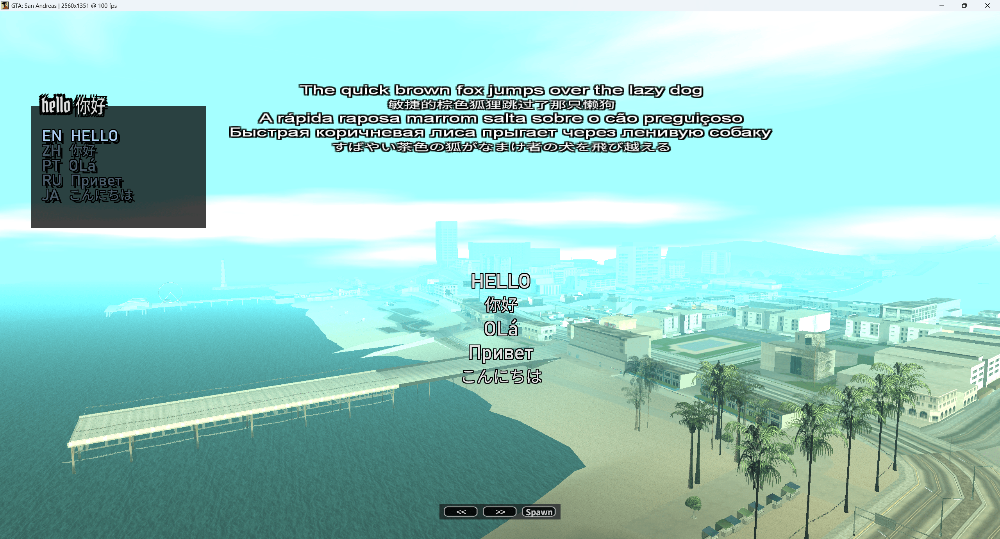

# samp-unicode

[English](README.md) | [简体中文](README.zh-CN.md) | [Português (BR)](README.pt-BR.md) | [日本語](README.ja-JP.md) | **Русский**

Клиентский мод (`.asi`) для SA-MP, который рисует **весь текст клиента** настоящим
Unicode-шрифтом, чтобы серверный текст в любой кодировке — GBK, Big5, Shift-JIS, EUC-KR,
кириллица, UTF-8 — отображался читаемо, а не «кракозябрами».

«Весь» — буквально: `TextDraw`, `GameText` и нативное `Menu`, а также всё, что клиент сам
рисует через `ID3DXFont` — чат и его строки, все стили диалогов, TAB-табло, 3D-метки,
никовые плашки, пузыри чата, окно убийств, текст на материалах объектов и номерной знак.
Собственное декодирование клиента (системная ANSI-кодовая страница) больше не видит ни
одной строки: байты декодируются один раз этим модом и рисуются шрифтом, у которого есть
нужные глифы.

Игра сохраняет собственную раскладку, тайминги, цвет и видимость; меняются только глифы.
Латинский текст, нарисованный четырьмя исходными гарнитурами `TextDrawFont`, сохраняет эти
гарнитуры, CJK переключается на Unicode-шрифт отображения, и каждая поверхность сохраняет
ту тень, которую запросил сам клиент. Чего мод изменить не может — это то, что **вводят**:
строку чата и поле ввода диалога клиент читает обратно однобайтовыми символами в
**системной ANSI-кодовой странице**, поэтому символ, которого в этой странице нет,
теряется при отправке ([Ограничения](#ограничения)).



*TextDraw справа, нативное меню слева, GameText внизу — одни и те же пять языков, нарисованные модом.*

## Установка

1. Скопируйте `samp-unicode.asi` (и, если нужна готическая гарнитура,
   `font0.ttf`) в `GTA San Andreas\modloader\samp-unicode\` — или в любое другое
   место, откуда подхватывает ASI-загрузчик.
2. Запустите игру один раз. Рядом с `.asi` появятся `samp-unicode.ini` и
   `samp-unicode.log`.

## Совместимость

Этот мод заменяет текст, который рисует игра, поэтому не может делить этот текст с другим
модом, делающим то же самое. **Одновременно должен работать только один мод, заменяющий
текст.**

| Конфликты | Почему |
|---|---|
| Другие моды шрифтов для SA-MP с китайским/кириллическим текстом | Оба перехватывают `CTextDraw::Draw` / `CGame::DisplayGameText` / `CFont::PrintString` и оба обнуляют исходный текст. В лучшем случае строки рисуются дважды (по разу каждым шрифтом), в худшем каждый мод стирает то, что хотел нарисовать другой, и текст исчезает или превращается в пробелы. |
| «GameText fix» / клиентские хелперы `fixes.inc`, которые тоже патчат `CGame::DisplayGameText` | Та же функция, оба патчат одни и те же байты. Обычно побеждает тот, кто установился вторым, а трамплин другого остаётся указывать на пропатченный код. |
| Любой оверлей, подменяющий устройство D3D9 прокси-объектом | Мод отказывается перехватывать устройство, чья vtable находится в куче (иначе он конфликтовал бы с прокси). Он пишет в лог `proxy object, leaving it alone` и ничего не делает: показывается собственный растровый текст игры, ничего не ломается. |

Известно, что рядом с ним работают (проверено на реальной установке): сам modloader, SilentPatch,
`III.VC.SA.LimitAdjuster`, WidescreenFix, WindowedMode, FramerateVigilante,
PreciseFramerateLimiter, SAMPGraphicRestore/ENB и CLEO-скрипты, которые сами не рисуют
текст.

Если в логе есть `endpoint ... already hooked` или каждая строка на экране отображается
дважды, значит, на том же месте работает другой мод: отключите его и перезапустите игру.

## Настройка

```ini
[font]
file =
family =
collection = 0
face =
font0 =
font1 =
font2 =
font3 =
size_divisor = 50
baseline_offset = 0
glyph_gamma = 1.00
antialias = on
outline_raster = off
shadow = on
letter_width = on
client_glyphs = on
shadow_offset = 1, 1

[textdraw]
fonts = 0, 1, 2, 3
brace_colors = off
scoreboard_layer = under

[menu]
enabled = on
font = 2
title_font = 0
title_scale = 1.00
title_dy = 0
title_width = 0.80
hscale = 1.00
align = 0
glyph = 1.0
outline = 1
shadow = 3
title_outline = 2
title_shadow = 0
shadow_color = 000000
shadow_alpha = 255
color = 0

[gametext]
enabled = on
fade_out = on
ignore_styles = none
scale = 0.82

[paths]
client_text = draw
client_text_font = 4
client_text_chat_font = 4
client_text_weight = 0
client_text_chat_shadow = 2
client_text_shadow_alpha = 255
client_text_drop_shadows = on
client_text_font_level = on
client_text_wrapper = on
client_text_wrapper_wide = on
client_text_ascii = ours
client_text_braces = on
client_text_tab = 4
client_text_line = 1.05
client_text_outline = auto

[encoding]
charset = auto
utf8_first = on
redraw_ascii = on
detect = on
single_byte = detect

[overlay]
hook_point = endscene

[debug]
log = on
verbose = off
```

| Ключ | По умолчанию | Описание |
|---|---|---|
| `font.file` / `font.family` | пусто | Шрифт отображения: гарнитура, которая несёт кодировку сервера. `family` принимает список в стиле CSS (`Noto Sans SC, Microsoft YaHei, sans-serif`); побеждает первая существующая запись, покрывающая кодировку, при этом понимаются `sans-serif` / `system-ui` / `serif`. Записи можно заключать в кавычки, как в CSS (`"Source Han Sans SC"`), — это также позволяет использовать запятую внутри имени. Пусто = `samp-unicode.ttf` рядом с .asi, затем встроенный порядок (YaHei, Noto Sans SC, Source Han Sans, PingFang, HarmonyOS Sans, MiSans, SimHei, SimSun, KaiTi, …). |
| `font.collection` | `0` | Индекс внутри `.ttc`. Гарнитуры без имени пропускаются автоматически. |
| `font.face` | пусто | Имя семейства для `.ttc`, у которого непригодна таблица имён (`simsun.ttc`); если пусто, имя читается из файла. |
| `font.font0..3` | пусто | Гарнитура для `TextDrawFont` 0–3: имя установленного семейства, файл шрифта или пусто = `fontN.ttf` / `samp-unicode-fontN.ttf` из папки мода, иначе ближайшая установленная гарнитура. |
| `font.size_divisor` | `50` | Высота в пикселях = `letter_height * screen_height / size_divisor`. 50 — строка той же высоты, что и ячейка клиента (20H); прежнее значение 60 уменьшало всё примерно на 18%. Увеличьте, если текст вылезает из рамки. |
| `font.baseline_offset` | `0` | Вертикальный сдвиг в пикселях. |
| `font.shadow` / `font.shadow_offset` | `on` / `1, 1` | Необязательная тень, смещение в пикселях. |
| `font.letter_width` | `on` | Растягивать каждый фрагмент текста до ширины, которую игра отвела по `letterWidth` (сохраняет пропорции, заданные сервером). |
| `font.client_glyphs` | `on` | Рисовать тот символ, который рисует сама гарнитура клиента для части пунктуации (в гарнитуре 2 `]` — звезда, `[` не рисуется вовсе). `off` оставляет обычные скобки. |
| `overlay.hook_point` | `endscene` | `endscene` рисует в EndScene, поэтому другие оверлеи (окно F9 omp-client, RTSS, ImGui-моды) рисуются поверх нас - это значение по умолчанию. `present` ставит нас выше всех остальных оверлеев и перекрывает собственное окно omp-client. |
| `textdraw.fonts` | `0, 1, 2, 3` | Идентификаторы шрифтов для перерисовки; `4`/`5` — спрайты и предпросмотр модели. `all` = все идентификаторы. |
| `textdraw.brace_colors` | `off` | Также понимать `{RRGGBB}` / `{RRGGBBAA}` как смену цвета; сам клиент этого не делает. |
| `textdraw.scoreboard_layer` | `under` | `under` рисует слой GameText **до** панели табло; панель полупрозрачна, поэтому текст просвечивает сквозь неё — как GameText самого клиента. `hide` не рисует, пока панель открыта (запасной вариант, если перехват отрисовки панели недоступен). |
| `menu.enabled` | `on` | Перехватывать текст Menu (заголовок, заголовки столбцов, строки). |
| `menu.font` | `2` | Гарнитура для строк меню: `0`–`3`, см. `[font]`. |
| `menu.hscale` | `1.00` | Горизонтальное сжатие текста меню. Символы, отрисованные через GDI, идут чуть шире собственных метрик клиента; `0.95`–`1.00` приближает ширину строки, не меняя высоту. |
| `menu.outline` / `menu.shadow` | `1` / `3` | Строки: обводка и тень; обе задаются в расчёте на опорный размер 20 px и масштабируются. Тень рисуется под обводкой, поэтому видна только тогда, когда больше обводки. |
| `menu.shadow_color` / `menu.shadow_alpha` | `000000` / `255` | Цвет тени (RRGGBB) и её альфа, чтобы тень могла быть мягче обводки. |
| `menu.title_outline` / `menu.title_shadow` | `2` / `0` | То же для заголовка, который рисуется намного крупнее строк. |
| `menu.title_scale` / `menu.title_dy` | `1.00` / `0` | Множитель размера и смещение в пикселях только для заголовка. Клиент рисует заголовок крупнее строк и позволяет ему пересекать верхний край панели. |
| `menu.title_width` | `0.80` | Ширина глифа заголовка относительно глифа строки. Шрифт заголовка в клиенте узкий, но с широким шагом, и заменяющий шрифт не совпадёт по обоим; 0.80 воспроизводит ширину клиента (`hello` = 71 px при высоте 40 px). |
| `menu.title_font` | `0` | Гарнитура заголовка меню. Клиент рисует заголовок гарнитурой 0 (той же, что использует `TextDrawFont 0`), поэтому она и стоит по умолчанию. |
| `menu.align` | `0` | Выравнивание пера: `0` = текст начинается с x, `1` = по центру, `2` = по правому краю. |
| `menu.glyph` | `1.0` | Множитель размера текста меню (`1.0` = размер, который использует сама игра). |
| `menu.outline` | `2` | Чёрная обводка в пикселях **при размере глифа 20 px**; заголовок рисуется намного крупнее, поэтому его обводка масштабируется вместе с размером (2 превращается в 4 при 40 px). |
| `menu.shadow` | `0` | Дополнительная тень в пикселях. |
| `menu.color` | `0` | `RRGGBB`, чтобы принудительно задать один цвет; `0` = использовать цвет, который игра задала для этой строки. |
| `gametext.ignore_styles` | `none` | Стили, которые остаются на собственном рендерере игры (`0`–`6`); `none`/`all`. |
| `gametext.enabled` | `on` | Перехватывать GameText вообще. `off` оставляет все сообщения клиенту. |
| `gametext.scale` | `0.82` | Множитель встроенной высоты текста по стилям. 0.82 измерено по GameText самого клиента: 45 px высоты строки у клиента против 55 px здесь при 1.0, тот же стиль и разрешение. |
| `gametext.fade_out` | `on` | Затухание в последние ~400 мс. Выключение обрывает сообщение на полной яркости. |
| `encoding.charset` | `auto` | `auto`, имя (`gbk`, `big5`, `sjis`, `euc-kr`, `cp1251`, `utf-8`, …) или число. |
| `encoding.utf8_first` | `on` | Сначала пробовать строгий UTF-8, затем кодировку. |
| `encoding.redraw_ascii` | `on` | Рисовать чисто ASCII-текст нашим рендерером тоже. Включено по умолчанию: одна гарнитура и один размер для всех строк, и строка со смешанным латинским и CJK текстом не меняет форму посередине. `off` оставляет строки только на английском растровой гарнитуре клиента. |
| `encoding.textdraw_underscore_space` | `on` | В TextDraw вместо пробела часто пишут "_", и строка выглядит как `Progreso_Premio_V.I.P` или `/TURBO_PARA_ON_OFF`. Включено рисует пробел. Только текст TextDraw: в чате, диалогах и никах игроков подчёркивания сохраняются, потому что там они часть имени. |
| `encoding.detect` | `on` | При `auto` определять кодировки CJK/кириллицы. Пара байтов, допустимая и в UTF-8, и в устаревшей кодовой странице, считается устаревшей CJK. |
| `debug.log` / `debug.verbose` | `on` / `off` | Переключатель файла лога и подробность по каждой текстуре. |

`auto` означает ANSI-кодовую страницу Windows игрока, поэтому `欢迎来到服务器` (GBK),
`日本語のテスト` (Shift-JIS) или `Привет` (CP1251) правильно декодируются в любой
системе, если включён `detect = on`; Latin-1 никогда не переинтерпретируется.

**Определение — это догадка, а явно указанная кодировка лучше.** `charset = auto` —
эвристика: короткая строка без пробелов действительно неоднозначна (`D2 BB` — это и
`一` в GBK, и допустимый символ UTF-8), и ни один детектор не разбирает все случаи.
На практике сервер отправляет всё в одной кодировке, поэтому укажите её —
`charset = 936` (или `950`, `932`, `949`, `1251`) — и мод перестаёт угадывать.
Смешанные варианты редки намеренно: сервер обычно не отправляет текст в кодировке,
которой нет в системе игрока, потому что чат, диалоги и таблица счёта по-прежнему идут
через собственное декодирование клиента, то есть системную кодовую страницу.

**Переопределение для отдельного сервера.** При запуске читается `samp-unicode.ini`, а
затем файл в папке `servers\`, названный по адресу, с которым запущен клиент: заход на
`127.0.0.1:7777` читает `servers\127.0.0.1_7777.ini`. Заменяются только те ключи, которые в
этом файле есть; остальные берутся снаружи. Имя — это адрес в нижнем регистре, где всё вне
`a-z 0-9 . _ -` записано как `_`, поэтому двоеточие становится подчёркиванием. При первом
подключении папка и шаблон с комментариями создаются сами; если папка недоступна для записи
(Program Files), об этом только пишется лог, и переопределения просто нет.

Именно это делает переключение между GBK-сервером и UTF-8-сервером удобным: каждый файл
называет свою кодировку `charset`, а базовый INI остаётся общим случаем. Автоопределение
слабее всего там, где строки короче — заголовок столбца меню или метка из двух символов, —
поэтому сервер с постоянной кодировкой стоит описать в его собственном файле.


## Сборка

```bat
msbuild samp-unicode.vcxproj /nologo /p:Configuration=Release /p:Platform=Win32
```

или `build.bat` из *x86 Native Tools Command Prompt*. Результат:
`bin\Release\samp-unicode.asi`. CI (Actions → build → Run workflow) собирает
Release и загружает `samp-unicode-release.zip` с `.asi`, сгенерированным
`.ini` и текстами лицензий.

## Как это работает

```
CTextDraw::Draw (text branch)  → collect text/position/size/colour, hide the
                                 game's glyphs, call the game function
CGame::DisplayGameText         → collect text/style/duration, feed spaces
CMenu::Show + display-list     → learn the menu title/rows and where they go
CFont::PrintString (menu text) → hide the line and draw it at the same pen
D3D9 Present (vtable)          → one textured quad per text run
D3D9 BeginScene (vtable)       → paste the background back on a frozen frame
```

Оверлей рисует на `Present`, поэтому поверхность, которую он захватывает, восстанавливает
и на которую рисует, — это та же поверхность, которая показывается на экране. Для меню это
важно: пока открыто меню или меню паузы, клиент перестаёт перерисовывать область, и
единственный способ убрать оттуда текст — вернуть фон на место; см.
[Известные проблемы](#известные-проблемы).

Текст проходит путь `bytes → UTF-16 → GDI raster → D3D9 texture → quad`, поэтому глифы
берутся из установленного шрифта, а не из фиксированного растрового шрифта GTA. TextDraw
сохраняют раскладку, тайминги и видимость игры; GameText размещается, отсчитывается по
времени и затухает в соответствии с таблицей стилей ниже.

- цвета: см. [Цвета](#цвета) ниже
- длинный текст: фрагмент, который не помещается в одну текстуру 4096x512, обрезается, а не
  отбрасывается
- переносы строк: `~n~` и настоящие переводы строк
- спрайты: идентификаторы шрифтов `4`/`5` используют другой рендерер (`CSprite2d`)
  и не затрагиваются

### Меню

`CMenu::Show` только строит панель; заголовок, заголовки столбцов и строки рисуются каждый
кадр через `CFont::PrintString` — поэтому меню показывает кракозябры, хотя остальной экран
в порядке. Мод перехватывает этот вызов, но берёт строку на себя только при выполнении всех
условий:

- меню на экране (`CMenu::Show` выполнялся в последние несколько секунд и обновляется,
  пока его текст продолжает рисоваться);
- строка не является чистым ASCII (английские строки сохраняют родной вид игры);
- строка нарисована с тем состоянием шрифта, которое использует само меню, — табло,
  3D-метки и чат используют другие размеры и проходят без изменений.

## Серверы со смешанными кодовыми страницами

Входящее направление не меняется: с этим модом или без него игрок отправляет байты ANSI-кодовой
страницы своей Windows, как и в оригинальном клиенте, поэтому сервер всегда декодирует их этой
страницей.
Исходящее отличается: для оригинального клиента кодируйте в той же странице; игроку с этим модом
отправляйте UTF-8 как есть - без декодирования и без угадывания, которое делает определение
однобайтовых страниц ненадёжным на коротких строках.

## Стили GameText

Стандартный клиент жёстко зашивает три особенности, которые
[open.mp](https://open.mp/docs/scripting/resources/gametextstyles) помечает как
*исправленные в fixes.inc / GameText+*:

| Стиль | Стандартный клиент | Здесь |
|---|---|---|
| 0 | всегда 9 с, стирает все остальные TextDraw и GameText | запрошенное время, остальное не затрагивается |
| 1 | затухает через 8 с и повторяется до истечения времени | показывается один раз в течение запрошенного времени |
| 5 | всегда 3 с, отбрасывает сообщения, приходящие слишком быстро | запрошенное время, без ограничения частоты |

Раскладки (позиция, размер, цвет, выравнивание, обводка) — те же, что эти фиксы строят из
textdraw, поэтому сообщение выглядит одинаково независимо от того, использует сервер
fixes.inc / GameText+ или отправляет GameText напрямую. `time = 0` означает «до замены».
Стили 7–15 — это стили HUD GTA, которые определяют только эти include-файлы, поэтому
прямой вызов с таким номером по-прежнему уходит в рендерер игры.

Сообщение скрывается, пока открыто меню паузы игры, а его таймер там замораживается и
возобновляется, как у собственных сообщений игры. Menu (`/menu`) не делает ни того, ни
другого: сообщение продолжает рисоваться и затухать по расписанию, поэтому открытие меню
никогда не меняет время его жизни.

## Шрифты

У исходного рендерера есть четыре гарнитуры для `TextDrawFont`, и каждый стиль GameText
выбирает одну из них:

| id | исходная гарнитура | стили GameText | установленная замена |
|---|---|---|---|
| 0 | готическая (blackletter) | 2 | Old English Text MT, Blackadder ITC, … иначе Times New Roman |
| 1 | жирный sans-serif | — | Arial |
| 2 | широкие прописные (Bank Gothic) | 3, 4, 5 | Bahnschrift |
| 3 | Pricedown | 0, 1, 6 | Impact |

В ZIP-архив релиза поставляется Pirata One (OFL, см. `THIRD_PARTY_NOTICES.md`) как
`font0.ttf`, поэтому id 0 и стиль GameText 2 сохраняют готический вид без установки
чего-либо; удалите этот файл, чтобы вернуться к заменяющей гарнитуре.

`font.family` принимает стек в стиле CSS: `family = Noto Sans SC, Microsoft YaHei,
sans-serif`. Записи пробуются по порядку, и используется первая существующая гарнитура,
покрывающая кодировку сервера; `sans-serif` / `system-ui` и `serif` раскрываются во
встроенные порядки (порядок для serif начинается с SimSun и Noto Serif SC). Это переносимый
способ запросить хорошую CJK-гарнитуру на машинах, которые вы не контролируете.

Встроенный порядок — это одна таблица в `src/font.cpp`: каждая запись называет
письменности, которые она обслуживает, а письменность активной кодовой страницы решает,
какие записи вообще подходят.

| кодовая страница | первые записи |
|---|---|
| 932, японская | Yu Gothic, Meiryo, MS Gothic |
| 949, корейская | Malgun Gothic, Gulim |
| 950, традиционный китайский | Microsoft JhengHei, MingLiU |
| 936, упрощённый китайский / 65001 | Noto Sans SC, Noto Sans CJK SC, Source Han Sans SC/CN, **Microsoft YaHei**, YaHei UI, PingFang SC, Hiragino Sans GB, HarmonyOS Sans SC, MiSans, WenQuanYi Micro Hei, SimHei, DengXian |

Serif-гарнитуры (SimSun, NSimSun, KaiTi, Noto Serif SC, Songti SC, …) находятся в той же
таблице за флагом `serif`, латинская основа (Arial, Tahoma, Segoe UI, …) идёт после
CJK-записей, а Arial Unicode MS служит запасным вариантом покрытия. Гарнитура не той
письменности пропускается, а не используется с неправильными формами глифов: японская
страница, отрисованная упрощёнными китайскими формами, — это ошибка рендеринга, а не выбор
стиля.

**Два уровня.** `font.file` / `font.family` — шрифт отображения: тот, который должен нести
кодировку сервера (CJK). `font0..font3` — четыре латинские гарнитуры исходного рендерера.
Каждый символ рисуется гарнитурой своего TextDrawFont id, а если в этой гарнитуре нет
глифа — а это любой CJK-символ, поскольку все четыре гарнитуры только латинские, — его
рисует шрифт отображения. Так латиница, цифры и символы берутся из `font0..3`, а CJK —
всегда из `file`/`family`; в одной строке могут соседствовать `SAMP` в Pricedown и 你好
шрифтом отображения.

`font0..font3` выбирают гарнитуру в таком порядке:

1. значение из INI — `font1 = Arial` (установленное семейство) или
   `font2 = C:\Fonts\BankGothic.ttf` (файл, установка не нужна; относительный путь сначала ищется рядом с .asi, затем в папке игры);
2. `font0.ttf` … `font3.ttf` (или `samp-unicode-font0.ttf` …) рядом с .asi;
3. ближайшая установленная гарнитура из таблицы выше.

Пусто означает «не задано», поэтому если оставить все четыре пустыми, будет использоваться
то, что установлено. TextDrawFont 2 рисуется прописными, потому что в исходной гарнитуре
нет строчных глифов.

## Проверено

TextDraw, GameText и оба перехвата меню были проверены во время выполнения на **0.3.7-R1**
и **0.3.DL-1**. Сигнатуры также совпадают без единого патча на:

- 0.3.7-R2, 0.3.7-R3-0, 0.3.7-R3-1, 0.3.7-R4, 0.3.7-R5-1
- 0.3.DL-1

Мод определяет сборку по совпадению байтов, а не по номеру версии или жёстко заданному
адресу, поэтому сборка, которой нет в этом списке, либо совпадает по тем же сигнатурам,
либо остаётся нетронутой — в логе указано, что найдено, а что пропущено.

## Цвета

Здесь используются три разных синтаксиса, и они **не** взаимозаменяемы.

**Скриптовые функции** (`TextDrawColor`, `TextDrawBoxColor`, `SendClientMessage`, …)
принимают `0xRRGGBBAA` — красный, зелёный, синий, затем альфа, как описано в
[списке цветов open.mp](https://open.mp/docs/scripting/resources/colorslist). То есть
`0xFF0000FF` — непрозрачный красный, `0xFF000080` — полупрозрачный красный, а
`0xFF000000` — красный с альфой 0, то есть невидимый. Записать здесь `0xAARRGGBB` —
классическая ошибка: `0xFF000000` тогда выглядит как чёрный, а бокс с `0x8000FF00` молча
исчезает.

**Внутри строк TextDraw и GameText** клиент использует цветовые коды GameText, а не числа:

| Код | Цвет | Примечания |
|---|---|---|
| `~r~ ~g~ ~b~ ~p~ ~y~` | красный, зелёный, синий, фиолетовый, жёлтый | `~h~` после кода осветляет его на один шаг; клиент допускает 5/4/3/2/2 уровня |
| `~w~` / `~s~` | белый | один и тот же цвет, два написания |
| `~l~` | серый | нельзя осветлить |
| `~h~` | осветление | применяется к цвету перед ним |

Нецветовые коды: `~n~` — перенос строки, `~u~ ~d~ ~<~ ~>~` — серые стрелки (рисуются
текстурами самого клиента; если их не удалось прочитать, берутся стрелки Unicode),
`~]~` — **ничего не рисует** (проверено на оригинальном клиенте; звёздочка из документации
не появляется), `~k~~KEY~` — привязка клавиши. Все они разбираются так же, как
это делает клиент, а затем рисуются оверлеем.

**Чат, диалоги и 3D-метки** этот мод не затрагивает, но для справки: они используют
синтаксис встраивания клиента `{RRGGBB}` — шесть шестнадцатеричных цифр, **без альфы**,
без префикса `0x`.

`{...}` **не** является частью синтаксиса TextDraw или GameText клиента: open.mp прямо
говорит, что встраивание цвета «не работает в textdraws», поэтому стандартный клиент
рисует фигурные скобки как есть. По умолчанию мод следует этому — TextDraw с `{FF0000}`
показывает буквальный текст, точно как клиент. Установка

```ini
[textdraw]
brace_colors = on
```

включает парсер как расширение и дополнительно принимает восьмизначную форму `{RRGGBBAA}`
(тот же порядок, что и у любого другого цвета SA-MP).

`[menu] color` задаётся в формате `RRGGBB` без альфы — оверлей сам добавляет `FF`, поэтому
`color = FF8800` — непрозрачный оранжевый.

## Известные проблемы

**Анимированные TextDraw могут съезжать.** Текст TextDraw набирается замещающими шрифтами
из `[font] font0..font3`, они пропорциональные, а собственные шрифты TextDraw в клиенте -
растровые с фиксированной ячейкой. Сервер, который анимирует TextDraw, подменяя буквы
пробелами (бегущее имя сайта, заголовок в стиле печатной машинки), рассчитывает именно на
ширину ячеек, поэтому буквы начинают наезжать друг на друга или расходиться. Ни один
замещающий шрифт не вернёт исходные ширины: исключите этот id из `[textdraw] fonts`
(например `fonts = 1, 2, 3`), чтобы его рисовал клиент, либо укажите для нужного `fontN`
моноширинный шрифт.

**Меню и меню паузы больше не оставляют после себя текст.** В старых сборках это было так:
когда открыто Menu (`/menu`) или меню паузы, клиент перестаёт перерисовывать область,
поэтому истёкшее сообщение сохраняло свои последние пиксели — а затухание делало хуже,
потому что смешивание может только смещать пиксели в сторону фона, но никогда не
восстанавливает его.

Оверлей рисуется на `Present` и хранит копию прямоугольника, на который рисует, сделанную
в предыдущем кадре, поэтому оба случая обрабатываются:

- **живой кадр** — игра перерисовывает область, поэтому оверлей просто перестаёт рисовать,
  и текст исчезает. Ничего не вставляется обратно.
- **замороженный кадр** (меню паузы, нативное Menu) — сохранённый фон сначала закрашивается
  обратно, в `BeginScene` и до того, как рисует клиент, поэтому меню не перекрывается ни на
  один кадр. Восстановление на `Present` вместо этого вставило бы старый фон поверх меню —
  та вспышка, которую раньше давала последовательность `/gt`, затем `/menu`.

Что это значит на практике:

- GameText истекает по расписанию, пока открыто меню, и закрывается вместе с ним;
- меню паузы скрывает текст и замораживает его таймер (остаток времени проигрывается
  после возобновления), как и клиент;
- замена сообщения (`/gt 0`, затем `/gt 1`) сразу убирает старое — слот GameText один,
  как и в клиенте;
- живой кадр никогда не затрагивается, поэтому ничего не мигает при замене сообщения или
  после его затухания.

**Если другой оверлей обходит цепочку Present клиента,** копия никогда не снимается, и
может проявиться старое поведение (текст остаётся, пока область не перерисована).
`debug.verbose = on` сообщает об этом: `bg: valid=1` означает, что копия работает;
`background copy failed (...)` указывает причину.
- **Примерно в одном запуске из трёх клиент закрывается сразу после старта**, ещё до того, как мод что-либо установил, и без окна с ошибкой. Журнал событий Windows каждый раз указывает одно и то же место (`samp.dll_unloaded`, смещение `0xFFF7D`, `0xC0000005`), и эта запись встречается и до появления мода, так что перерисовка тут ни при чём. Отмечено как `B20` в `REVIEW.md`.

## Особенности клиента, о которых стоит знать

**Четыре гарнитуры клиента переставляют знаки пунктуации.** У каждой гарнитуры своя таблица глифов, и часть ASCII-пунктуации указывает не на сам символ, а на раздел символов этой таблицы. Замер одной пробной строкой на гарнитуру (`[ ] { } | \ ^ _ ` @ # $ & * ( ) < > ? / : ; , . = + - A Z a z 0 9`) даёт две крайности:

| отправлено | гарнитура 0 рисует | гарнитура 1 рисует |
|---|---|---|
| `[` `]` | звезду, затем `?` | `[` `]` |
| `(` `)` | `<` `>` | `(` `)` |
| `{` `}` | квадратик, затем `\` | `P` `§` |
| `*` | `[` | квадратик |
| буквы, цифры | без изменений | без изменений |

Это свойство раскладки шрифта, а не разбор строки, и мод **намеренно его не повторяет**: рисуется то, что прислал сервер, поэтому `[` остаётся `[` в любой гарнитуре. Повторить — значит нарочно превращать читаемую пунктуацию в другую (`(A)` стало бы `<A>`). `~]~` — другое: этот код не рисует ничего.

- Пустой `TextDraw` или состоящий из одних пробелов не рисуется вообще — даже его бокс, —
  поэтому сервер не может использовать «пустой текст с боксом» как маску.
- Цвета в скриптовом API — `0xRRGGBBAA`: `0x00000000` невидим, `0x000000AA` — чёрный
  с непрозрачностью 67%.
- `TextDrawTextSize` — это **правый нижний угол** бокса для текстовых шрифтов и
  ширина/высота для шрифтов спрайтов и предпросмотра; начало бокса находится на 10 единиц
  выше и на 5 левее позиции `TextDrawCreate`.

## Ограничения

- только `gta_sa.exe` 1.0 (указатель устройства D3D и флаги паузы, которые он читает,
  соответствуют раскладке 1.0).
- Эмодзи декодируются правильно, но GDI рисует их монохромными.
- **Вводимый текст при отправке остаётся однобайтовым.** Строка чата и поле
  `INPUT`/`PASSWORD` в диалоге — это собственные элементы `CDXUTIMEEditBox` клиента:
  компоновка IME работает, поле хранит символы в широком виде, и мод рисует то, что в нём
  находится, — но клиент читает его обратно через `GetText()`, который возвращает `char*` в
  **системной ANSI-кодовой странице** (`CInput::ProcessInput` и ответ диалога делают
  `strncpy` именно из него). Символ, которого в этой странице нет, теряется в этот момент,
  ещё до того, как его увидит сервер. То, что приходит от сервера, мод декодирует и рисует
  как любой другой текст.

## Лицензия

MIT. Встроенный детектор кодировок распространяется по Apache-2.0; см.
[THIRD_PARTY_NOTICES.md](THIRD_PARTY_NOTICES.md).

### Текст клиента

Клиент рисует текст интерфейса своим `ID3DXFont` однобайтовыми строками: чат, таблица счёта,
все стили диалогов, 3D-метки, ники, пузыри чата, окно смерти, текст материала объекта и номерной
знак. Всё это теряет символы, которых нет в ANSI-кодовой странице. `[paths] client_text = draw`
перехватывает эти отрисовки и рисует их шрифтом мода.

Работает на **всех сборках, которые предлагает лаунчер** (0.3.7-R1…R5 и 0.3.DL). Ничто не
привязано к адресам конкретной сборки: три сигнатуры ищутся в `.text`, vtable обёртки
**ищется** (таблица из 18 слотов в `.rdata`, слот 14 указывает на функцию со проверкой
`cmp eax, 0x186A0`), а решение «тень или тело» принимается по **форме вызовов** (четыре чёрных,
затем тело; пятый вызов - тело, даже если оно чёрное).

Текст панели записывается во время её отрисовки и рисуется после возврата, потому что клиент
заливает полупрозрачный фон уже после текста. `CDXUTDialog::OnRender` рисует внутри открытого
пакета спрайтов, поэтому перенаправляются точки вызова, а не вход. Текст, идущий в текстуру,
рисуется после закрытия пакета.

`\t` означает два столбца только в `TABLIST` и `TABLIST_HEADERS`; в остальных четырёх стилях
он разворачивается в `client_text_tab` пробелов.

Подробности - в `src/hooks.cpp`, рядом с соответствующим кодом.
