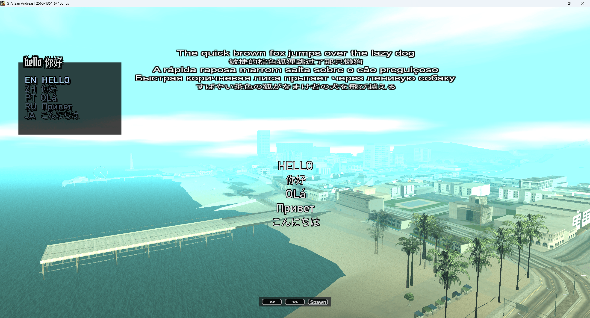

# samp-unicode

[English](README.md) | [Português (BR)](README.pt-BR.md) | [Русский](README.ru-RU.md) | [日本語](README.ja-JP.md) | **简体中文**

一个 SA-MP 的**客户端 mod**（`.asi`）：用系统里的 Unicode 字体重画**客户端所有的文字** ——
`TextDraw`、`GameText`、原生 `Menu`，以及客户端自己用 `ID3DXFont` 画的全部界面文字：
聊天框和聊天行、六种对话框、TAB 记分板、3D 文字标签、玩家名牌、聊天气泡、死亡面板、
物体材质文字、车牌。服务器发 GBK、Big5、Shift-JIS、EUC-KR、西里尔或 UTF-8，玩家看到的
都是正常的字，不是乱码。

"全部"是字面意思：字节由本 mod 解码一次，再交给有字形的字体去画，客户端自己那套
**系统 ANSI 代码页**解码不再参与。唯一改不动的是**玩家输入的内容**：聊天输入行和对话框
输入框由客户端用 `GetText()` 按单字节读回，代码页表示不了的字符在提交时就已经丢了
（见[限制](#限制)）。

布局、计时、颜色和可见性都还是游戏自己的，只有字形换了：原本用四种
`TextDrawFont` 画的拉丁文保留原来的字体，中文回退到 Unicode 显示字体，每个界面还保留
客户端自己要求的阴影厚度。



*右边是 TextDraw，左边是原生菜单，底部是 GameText —— 同样五种语言，全部由本 mod 绘制。*

## 安装

1. 把 `samp-unicode.asi`（想要黑体花体的话再加上 `font0.ttf`）放进
   `GTA San Andreas\modloader\samp-unicode\`，或者任何 ASI 加载器会读取的位置。
2. 启动一次游戏，`.asi` 旁边会生成 `samp-unicode.ini` 和 `samp-unicode.log`。

## 兼容性

这个 mod 会**替换游戏原本绘制的文字**，所以它不能和另一个做同样事情的 mod 共存。
**同一时间只运行一个“改文字”的 mod。**

| 会冲突 | 原因 |
|---|---|
| 其它 SA-MP 中文字体 mod / 西里尔字体 mod | 都钩 `CTextDraw::Draw` / `CGame::DisplayGameText` / `CFont::PrintString`，都会把原文隐藏掉。轻则文字被画两遍（两套字体叠加），重则互相抹掉对方要画的内容，文字消失或变成一片空白。 |
| 那些同样改 `CGame::DisplayGameText` 的 “GameText 修复” 补丁 | 同一个函数、同一段字节。后装的那个通常赢，另一个的跳板会指向已被改写的代码。 |
| 用代理对象替换 D3D9 设备的覆盖层 | mod 拒绝钩挂 vtable 位于堆内存的设备（会跟代理打架）。日志会写 `proxy object, leaving it alone`，此时 mod 变成空操作：显示游戏原本的点阵文字，但不会崩。 |

实测可以共存（在真实安装上跑过）：modloader 本体、SilentPatch、`III.VC.SA.LimitAdjuster`、
WidescreenFix、WindowedMode、FramerateVigilante、PreciseFramerateLimiter、
SAMPGraphicRestore/ENB，以及不自己画文字的 CLEO 脚本。

如果日志里出现 `... already hooked`，或者屏幕上每段文字都变成两份，说明还有别的 mod
在同一处：关掉它再重启游戏。

## 配置

```ini
[font]
file =
family =
collection = 0
face =
font0 =
font1 =
font2 =
font3 =
size_divisor = 50
baseline_offset = 0
glyph_gamma = 1.00
antialias = on
outline_raster = off
shadow = on
letter_width = on
client_glyphs = on
shadow_offset = 1, 1

[textdraw]
fonts = 0, 1, 2, 3
brace_colors = off
scoreboard_layer = under

[menu]
enabled = on
font = 2
title_font = 0
title_scale = 1.00
title_dy = 0
title_width = 0.80
hscale = 1.00
align = 0
glyph = 1.0
outline = 1
shadow = 3
title_outline = 2
title_shadow = 0
shadow_color = 000000
shadow_alpha = 255
color = 0

[gametext]
enabled = on
fade_out = on
ignore_styles = none
scale = 0.82

[paths]
client_text = draw
client_text_font = 4
client_text_chat_font = 4
client_text_weight = 0
client_text_chat_shadow = 2
client_text_shadow_alpha = 255
client_text_drop_shadows = on
client_text_font_level = on
client_text_wrapper = on
client_text_wrapper_wide = on
client_text_ascii = ours
client_text_braces = on
client_text_tab = 4
client_text_line = 1.05
client_text_outline = auto

[encoding]
charset = auto
utf8_first = on
redraw_ascii = on
detect = on
single_byte = detect

[overlay]
hook_point = endscene

[debug]
log = on
verbose = off
```

| 键 | 默认 | 说明 |
|---|---|---|
| `font.file` / `font.family` | 空 | 显示字体：用来承载中文等字符的那个字体。`family` 支持和 CSS 一样的列表（`Noto Sans SC, Microsoft YaHei, sans-serif`），按顺序取第一个存在且覆盖当前字符集的；`sans-serif` / `system-ui` / `serif` 这类通用名也认；名字可以像 CSS 那样加引号（`"Source Han Sans SC"`），引号内的逗号不会被当成分隔符。留空 = `.asi` 同目录的 `samp-unicode.ttf`，再按内置顺序（雅黑、Noto Sans SC、思源黑体、苹方、HarmonyOS Sans、MiSans、黑体、宋体、楷体 …）。 |
| `font.collection` | `0` | `.ttc` 里的索引；没有名字表的 face 会自动跳过。 |
| `font.face` | 空 | 给名字表不可用的 `.ttc`（如 `simsun.ttc`）手动指定家族名；留空则从文件读取。 |
| `font.font0..3` | 空 | `TextDrawFont` 0–3 用的字体：装好的字族名、字体文件，或留空 = 插件目录的 `fontN.ttf` / `samp-unicode-fontN.ttf`，再退到最接近的已安装字体。 |
| `font.size_divisor` | `50` | 像素高度 = `letter_height * 屏幕高度 / size_divisor`。50 = 和客户端一行（20H）等高；原来默认的 60 会让整页小约 18%。文字撑出框就调大这个值。 |
| `font.baseline_offset` | `0` | 垂直微调，单位像素。 |
| `font.shadow` / `font.shadow_offset` | `on` / `1, 1` | 可选投影，偏移单位像素。 |
| `font.letter_width` | `on` | 把每一段拉伸到游戏按 `letterWidth` 预留的宽度（保留服务器的宽高比）。 |
| `font.client_glyphs` | `on` | 对少数标点，画客户端自己字体画的那个符号（font 2 的 `]` 是五角星、`[` 什么都不画）；`off` 保留原样括号。 |
| `overlay.hook_point` | `endscene` | `endscene` 在 EndScene 绘制，所以别的叠层（omp-client 的 F9 窗口、RTSS、ImGui mod）画在我们上面。这是默认值：在 Present 绘制时我们曾盖住 omp-client 自己的窗口。`present` 让我们盖在所有叠层之上。 |
| `textdraw.fonts` | `0, 1, 2, 3` | 要重画的字体 id；`4`/`5` 是精灵和模型预览。`all` = 全部。 |
| `textdraw.brace_colors` | `off` | 是否把 `{RRGGBB}` / `{RRGGBBAA}` 花括号也当颜色变化（客户端本身不解析，只有服务端故意输出时才有意义）。 |
| `textdraw.scoreboard_layer` | `under` | `under` = GameText 图层在计分板面板**之前**绘制，面板盖住它；因为面板是半透明的，文字会**透出来**，和客户端自己的 GameText 一致。`hide` = 面板打开时不画（钩不上面板绘制时的回退）。 |
| `menu.enabled` | `on` | 接管 Menu 的文字（标题、列头、条目）。 |
| `menu.font` | `2` | 菜单条目的字体：`0`–`3`，见 `[font]`。 |
| `menu.hscale` | `1.00` | 菜单文字的横向压缩。GDI 的字宽比客户端自己的字体度量略宽，`0.95`–`1.00` 能让行宽更接近，高度不变。 |
| `menu.outline` / `menu.shadow` | `1` / `3` | 行：描边与阴影，都按 20px 基准缩放；阴影画在描边**下面**，所以必须比描边大才看得见。 |
| `menu.shadow_color` / `menu.shadow_alpha` | `000000` / `255` | 阴影颜色（RRGGBB）与透明度。`255` 是纯黑（和游戏一致），降低会更柔和。 |
| `menu.title_outline` / `menu.title_shadow` | `2` / `0` | 标题用的同一对参数（标题字号明显更大）。 |
| `menu.title_scale` / `menu.title_dy` | `1.00` / `0` | 只作用于标题：尺寸倍数和像素偏移。客户端把标题画得比条目大，并让它压在面板顶边上。 |
| `menu.title_width` | `0.80` | 标题字形宽度（相对行字形）。原版标题字体窄、字距宽，替代字体无法同时匹配；0.80 标定到原版标题的占宽（`hello` 在 40 px 高时占 71 px）。 |
| `menu.title_font` | `0` | 菜单标题用的字体。客户端给标题用的就是 0 号字面（和 `TextDrawFont 0` 同一个），所以默认 0。 |
| `menu.align` | `0` | 笔的对齐：`0` = 从 x 开始，`1` = 居中，`2` = 右对齐。 |
| `menu.glyph` | `1.0` | 菜单文字的尺寸倍率（`1.0` = 游戏自己用的尺寸）。 |
| `menu.outline` | `2` | 黑色描边，单位是**20px 字高时的像素**；标题画得更大，所以描边随字号一起放大（40px 时 2 变 4）。 |
| `menu.shadow` | `0` | 额外投影，单位像素。 |
| `menu.color` | `0` | 填 `RRGGBB` 强制单色，`0` = 用游戏为该行设置的颜色。 |
| `gametext.ignore_styles` | `none` | 保留给游戏自己渲染的样式（`0`–`6`）；`none`/`all`。 |
| `gametext.enabled` | `on` | 是否接管 GameText；`off` 时所有消息交给客户端。 |
| `gametext.scale` | `0.82` | 内置每样式字高的倍率。0.82 是按客户端自身 GameText 实测的：同一分辨率、同一 style 下，单行字高原版 45 px，我们在 1.0 时 55 px。 |
| `gametext.fade_out` | `on` | 最后约 400ms 淡出。关掉则在满亮度时直接消失。 |
| `encoding.charset` | `auto` | `auto`、名称（`gbk`、`big5`、`sjis`、`euc-kr`、`cp1251`、`utf-8` …）或数字。 |
| `encoding.utf8_first` | `on` | 先按严格 UTF-8 试。 |
| `encoding.redraw_ascii` | `on` | 纯 ASCII 文本也交给我们的渲染器。默认开启：所有字符串用同一字体、同一字号，中英混排的行不会中途换形。`off` 时纯英文行仍用客户端自己的位图字体。 |
| `encoding.detect` | `on` | `auto` 时自动识别 CJK/西里尔编码。某组字节同时是合法 UTF-8 和合法传统 CJK 时，按传统 CJK 处理。 |
| `debug.log` / `debug.verbose` | `on` / `off` | 日志开关和逐纹理细节。 |

`auto` 指玩家的 Windows ANSI 代码页，所以 `欢迎来到服务器`（GBK）、
`日本語のテスト`（Shift-JIS）、`Привет`（CP1251）在 `detect = on` 时都能正确解出；
Latin-1 不会被二次解释。

**自动探测只是猜测，写明编码永远更可靠。** `charset = auto` 是启发式判断：短字符串、
没有空格时本来就有歧义（`D2 BB` 既是 GBK 的「一」，又是合法的 UTF-8 字符），任何探测器
都不可能百分百判对。实际部署里一个服务器通常只用一种编码，直接写明即可 ——
`charset = 936`（或 `950`、`932`、`949`、`1251`），mod 就不再猜。

决定**接管哪些界面**的 `[paths]` 一组键（`client_text = off | log | draw`、字体、宽度、
阴影厚度、是否丢弃客户端自己的阴影 pass）逐条写在下面的配置一节里。

**全局只有一套配置，短文本是最弱的一环。** 这个 mod 没有“按服务器 IP 分配置”的功能：
`samp-unicode.ini` 在启动时读一次，对之后连的服务器都生效。而自动探测恰恰在字符串最短的
地方最不可靠 —— 菜单列头、两个字的标签，字节太少，无从判断。所以在不同语言的服务器之间
来回切换的玩家，每次都得改 INI；这不是本 mod 打算支持的用法。

## 构建

```bat
msbuild samp-unicode.vcxproj /nologo /p:Configuration=Release /p:Platform=Win32
```

或者在 *x86 Native Tools Command Prompt* 里跑 `build.bat`。产物在
`bin\Release\samp-unicode.asi`。CI（Actions → build → Run workflow）会构建 Release
并上传 `samp-unicode-release.zip`，含 `.asi`、生成的 `.ini` 和许可证。

## 工作原理

```
CTextDraw::Draw（文字分支）  → 取文本/位置/大小/颜色，隐藏游戏字形，调用原函数
CGame::DisplayGameText      → 取文本/样式/时长，喂空格
CMenu::Show + 显示列表      → 学到菜单的标题/条目和它们的位置
CFont::PrintString（菜单）  → 抹掉该行，用同样的笔位自己画
D3D9 Present（vtable）      → 每段文字一个带纹理的四边形
D3D9 BeginScene（vtable）   → 冻结帧上先把背景贴回去
```

覆盖层在 `Present` 阶段绘制，所以“抓背景 / 回填 / 画字”作用的是**同一张会被显示的后缓冲**。
这对菜单很重要：菜单或暂停菜单打开时客户端不再重绘那片区域，唯一能擦掉文字的办法就是把背景
贴回去 —— 详见 [已知问题](#已知问题)。

文字走 `字节 → UTF-16 → GDI 光栅化 → D3D9 纹理 → 四边形`，字形来自安装的字体而不是
GTA 的固定点阵字体。TextDraw 保留游戏自己的布局、计时和可见性；GameText 按下表的样式
表定位、计时和淡出。

- 颜色：见下面的 [颜色](#颜色) 一节
- 长文本：放不进 4096x512 纹理的一段会被截断，而不是丢弃
- 换行：`~n~` 和真实换行
- 精灵：字体 `4`/`5` 走另一套渲染（`CSprite2d`），完全不碰

### Menu

`CMenu::Show` 只负责搭面板；标题、列头和条目是每帧由 `CFont::PrintString` 画的 ——
这就是为什么菜单会乱码而屏幕上其它文字正常。插件挂钩那个调用，但只有同时满足下面三条才
接管：

- 屏幕上有菜单（`CMenu::Show` 在最近几秒内跑过，且该菜单文字还在被绘制时不断续期）；
- 字符串不是纯 ASCII（英文条目保留游戏原本的样子）；
- 这一行用的字体状态和菜单自己用的一致 —— 记分板、3D 标签、聊天用的是别的字号，直接放行。

### 客户端文本

客户端用自己的 `ID3DXFont` 画界面文字，字符串是单字节的：聊天、计分板、各种对话框、3D 标签、名牌、
聊天气泡、死亡面板、对象材质文字、车牌，每一处都会丢掉 ANSI 代码页表示不了的字符。
`[paths] client_text = draw` 把这些绘制接管过来，用本 mod 的字体重新画，服务器里的中文聊天、
玩家名、对话框和招牌就能按原样显示。

整套在**启动器提供的所有版本上都有效**（0.3.7-R1 到 R5，以及 0.3.DL），不是只有 0.3.DL：

| 表面 | 通过什么接管 |
| --- | --- |
| 3D 标签、名牌、聊天气泡、计分板表头、对话框正文、下载窗口标题 | `CFonts::DrawText` / `DrawLittleText` |
| 聊天行、按钮、表格行、静态文本 | `CFontWrapper` 的 vtable |
| 对话框正文（再画一次，压在面板填充之上） | `CDialog::Draw` |
| 出生点按钮、服务器对话框、下载窗口列表 | `CDXUTDialog::OnRender` 的直接调用点 |
| 死亡面板名字 | 字体层，凭调用形态判断 |
| 对象材质文字、车牌 | 字体层与 wrapper，画进纹理里 |

**没有任何一处写死某个版本的地址**：三个签名在 `.text` 里匹配；wrapper 的 vtable 是**搜索**出来的
（`.rdata` 里 18 槽、槽 14 指向带客户端自己的 `cmp eax, 0x186A0` 长度守卫的函数），所以 0.3.7 上的
聊天和按钮也能接管；描边/正文的判定用**调用形态**（4 遍黑 + 正文，第 5 次就是正文，即使它是黑色）。

面板里的文字先记录、等面板画完再画，因为客户端是在文字之后才铺半透明填充。
`CDXUTDialog::OnRender` 是在已打开的 sprite 批次里绘制的，所以不动它的入口，而是重定向它的调用点。

画进纹理的文字在 sprite 批次关闭之后才画 —— 那是纹理仍是渲染目标、批次又已关闭的唯一时刻。

`\t` 只有 `TABLIST` 和 `TABLIST_HEADERS` 才表示两列，那里客户端自己拆分并逐格定位；
其余四种样式里 `\t` 展开成 `client_text_tab` 个空格，和 `DT_EXPANDTABS` 一致。

钩点、各版本实测偏移、以及试过但不可行的方案，都写在 `src/hooks.cpp` 里对应代码旁边。

## 混合代码页的服务器

输入方向不变：装不装本 mod，玩家发出来的都是他 Windows 的 ANSI 代码页字节（和原版一样），
所以服务端一律按该代码页解码。
输出方向不同：原版客户端按同一代码页编码；装了本 mod 的直接发 UTF-8 —— 不需要解码，也避开了
短文本单字节猜测定不准的问题。

## GameText 样式

原版客户端硬编码了三个怪癖，[open.mp 文档](https://open.mp/docs/scripting/resources/gametextstyles)
把它们标为 *fixed in fixes.inc / GameText+*：

| 样式 | 原版客户端 | 本插件 |
|---|---|---|
| 0 | 固定 9 秒，并且清空其它 TextDraw 和 GameText | 用服务器给的时长，不碰其它东西 |
| 1 | 8 秒后淡出并循环直到时间结束 | 只显示一次，用给的时长 |
| 5 | 固定 3 秒，发太快会被丢弃 | 用给的时长，无频率限制 |

布局（位置、大小、颜色、对齐、描边）就是那些 fix 用 textdraw 拼出来的样式，所以服务器
用 fixes.inc / GameText+ 还是直接发原生 GameText，看起来都一样。`time = 0` 表示
“直到被替换”。样式 7–15 是只有那些 include 才定义的 GTA HUD 样式，数字直接发过去仍由
游戏自己渲染。

菜单打开期间：ESC 暂停菜单会让消息**隐藏并冻结计时**（关掉后接着走，和游戏自己的消息
一样）；Menu（`/menu`）**什么都不做** —— 消息照常绘制、照常按时间淡出，开菜单不会
改变它能活多久。

## 字体

原版渲染器给 `TextDrawFont` 准备了四种字体，每个 GameText 样式各选一种：

| id | 原版字体 | GameText 样式 | 替代字体 |
|---|---|---|---|
| 0 | 黑体花体 | 2 | Old English Text MT、Blackadder ITC …否则 Times New Roman |
| 1 | 粗无衬线 | — | Arial |
| 2 | 宽体大写（Bank Gothic） | 3、4、5 | Bahnschrift |
| 3 | Pricedown | 0、1、6 | Impact |

发布包把 Pirata One（OFL，见 `THIRD_PARTY_NOTICES.md`）作为 `font0.ttf` 一起提供，
所以 id 0 和 GameText 样式 2 不用装字体也有花体效果；删掉该文件就回退到替代字体。

**两层字体。** `font.file` / `font.family` 是显示字体：负责承载中文的那一个。
`font0..font3` 是原版渲染器的四个拉丁字体。每个字符先用它 `TextDrawFont` 对应的字体画，
当那个字体没有该字形时（所有中文都是，因为四个字体只有拉丁），改用显示字体。于是拉丁、
数字和符号来自 `font0..3`，中文始终来自 `file`/`family`；一行里可以同时是 Pricedown 的
`SAMP` 和显示字体的 `你好`。

`font0..font3` 按这个顺序选字体：

1. INI 里的值 —— `font1 = Arial`（已安装的字族）或
   `font2 = C:\Fonts\BankGothic.ttf`（文件，不需要安装；相对路径先找插件目录，再找游戏目录）；
2. 插件目录下的 `font0.ttf` … `font3.ttf`（或 `samp-unicode-font0.ttf` …）；
3. 上表里最接近的已安装字体。

留空表示“没设置”，所以四个都不填就用系统里装的。`TextDrawFont 2` 按大写渲染，因为原版

内置顺序是 `src/font.cpp` 里的一张表：每条记录声明它服务哪些脚本，当前代码页决定哪些条目
有资格被选中。

| 代码页 | 优先条目 |
|---|---|
| 932 日文 | Yu Gothic、Meiryo、MS Gothic |
| 949 韩文 | Malgun Gothic、Gulim |
| 950 繁中 | Microsoft JhengHei、MingLiU |
| 936 简中 / 65001 | Noto Sans SC、Noto Sans CJK SC、Source Han Sans SC/CN、**Microsoft YaHei**、YaHei UI、PingFang SC、Hiragino Sans GB、HarmonyOS Sans SC、MiSans、WenQuanYi Micro Hei、SimHei、DengXian |

衬线字体（SimSun、NSimSun、KaiTi、Noto Serif SC、Songti SC …）在表里用 `serif` 标志区分，
拉丁基准字体（Arial、Tahoma、Segoe UI …）排在中文条目之后，Arial Unicode MS 作为覆盖兜底。
脚本不符的字体**直接跳过**，而不是拿错误字形硬渲染 —— 用简体字形渲染日文页面属于渲染错误，
不是风格选择。

那个字体没有小写字形。

## 已验证

TextDraw、GameText 以及两个菜单挂钩都在 **0.3.7-R1** 和 **0.3.DL-1** 上做过实机验证。
下列构建的字节签名也都能直接匹配、不需要打补丁：

- 0.3.7-R2、0.3.7-R3-0、0.3.7-R3-1、0.3.7-R4、0.3.7-R5-1
- 0.3.DL-1

mod 靠**字节签名**识别构建，不读版本号、也不依赖硬编码地址；因此不在这份列表里的构建
要么同样匹配，要么完全不被触碰 —— 日志会写明找到了什么、跳过了什么。

## 颜色

这里其实有**三种**写法，互不通用。

**脚本函数参数**（`TextDrawColor`、`TextDrawBoxColor`、`SendClientMessage` ……）是
`0xRRGGBBAA`——红、绿、蓝，最后才是 alpha，见
[open.mp 颜色列表](https://open.mp/zh-CN/docs/scripting/resources/colorslist)。
所以 `0xFF0000FF` 是不透明的红，`0xFF000080` 是半透明红，`0xFF000000` 是 alpha 为 0
的红色 —— 也就是看不见。按 `0xAARRGGBB` 写是最常见的坑：`0xFF000000` 看着像黑色，
而 `0x8000FF00` 的盒子会直接消失。

**TextDraw / GameText 字符串内部**用的是 GameText 的颜色代号，不是数字：

| 代号 | 颜色 | 说明 |
|---|---|---|
| `~r~ ~g~ ~b~ ~p~ ~y~` | 红、绿、蓝、紫、黄 | 后面接 `~h~` 提亮一级；客户端分别允许 5/4/3/2/2 级 |
| `~w~` / `~s~` | 白 | 同一个颜色，两种写法 |
| `~l~` | 灰 | 不能提亮 |
| `~h~` | 提亮 | 作用于它前面的颜色 |

非颜色代号：`~n~` 换行、`~u~ ~d~ ~<~ ~>~` 灰色箭头（直接用客户端自己的贴图，读不到才退回 Unicode 箭头）、
`~]~` **什么都不画**（原版实机截图确认；文档写的星号与实机不符）、`~k~~按键~` 键位提示。
这些和客户端一样解析，然后由覆盖层绘制。

**聊天、对话框、3D 标签**不在本 mod 范围内，但顺带一提：它们用客户端的嵌入语法
`{RRGGBB}`——六位十六进制、**没有 alpha**、没有 `0x` 前缀。

`{...}` **不属于**客户端的 TextDraw / GameText 语法：open.mp 原文写得很明确——
颜色嵌入“does not work in textdraws”（在文本绘图里无效），所以原版客户端会把大括号
原样画出来。本 mod 默认也照这个来：TextDraw 里写 `{FF0000}`，显示的就是这串字面文本，
和客户端一致。把

```ini
[textdraw]
brace_colors = on
```

打开后才会解析，并额外接受八位的 `{RRGGBBAA}`（顺序与其它 SA-MP 颜色一致）。

`[menu] color` 是 `RRGGBB`（无 alpha）—— 覆盖层自己补 `FF`，所以 `color = FF8800`
就是不透明白橙色。

## 已知问题

**动画 TextDraw 会出现错位。** TextDraw 的文字用 `[font] font0..font3` 里的替身字体排布，
它们是比例字体，而客户端自己的 TextDraw 字体是**定宽位图字体**。服务器常用"把字母换成空格"
来做动画（滚动的网址、打字机式标题），这依赖每个字符固定的格子宽度 —— 换成比例字体后，字母
就会重叠或散开。任何替身字体都还原不了原来的格宽：把那个字体 id 从 `[textdraw] fonts` 里排除
（例如 `fonts = 1, 2, 3`）交给客户端自己画，或者把对应的 `fontN` 指向等宽字体来对齐格子。

**菜单和暂停菜单都不会再留下文字。** 旧版本会：打开 Menu（`/menu`）或暂停菜单时，客户端
不再重绘那片区域，到期的消息就把最后的像素留在屏幕上 —— 而淡出反而更糟，因为混合只能把
像素推向背景，无法把背景恢复回来。

现在覆盖层在 `Present` 阶段绘制，并保留一份"它画过的那块矩形"的一帧背景副本，两种情况分别
处理：

- **活动帧**：游戏本来就会重绘那片区域，我们只要停止绘制，文字自然消失，**不做回填**；
- **冻结帧**（暂停菜单、原生 Menu）：先把保存的背景贴回去。这一步放在 `BeginScene`
  里，在游戏开始绘制之前完成，所以菜单不会有一帧被盖住。

实际效果：

- `/menu` 开着时 GameText 照常按时到期，关菜单时不会残留；
- ESC 暂停时隐藏文字并**冻结计时**（剩余时间在恢复后继续走），与客户端一致；
- 替换消息（`/gt 0` 再 `/gt 1`）时旧消息立即消失 —— 和客户端一样只有一个 GameText 槽位；
- **活动帧永远不做回填**，所以替换消息、淡出结束时都不会闪一下。

**如果客户端呈现路径被其它覆盖层（ENI/窗口化 mod 等）截断**，背景副本可能抓不到，旧行为
（文字留到该区域被重绘）仍可能出现。打开 `debug.verbose = on` 可确认：`bg: valid=1` 表示
副本工作正常，`background copy failed (...)` 会给出具体原因。
- **大约每三次启动会有一次，游戏刚起来就自己关掉**，此时 mod 还没有安装任何钩子，也没有崩溃对话框。Windows 事件日志每次都指向同一处（`samp.dll_unloaded`，偏移 `0xFFF7D`，`0xC0000005`），而这个记录在本 mod 介入之前就存在，所以不是重绘逻辑引起的。`REVIEW.md` 里编号 `B20`。

## 客户端的一些怪癖

**客户端的四个字体会置换标点。** 每个字体有自己的字形表，一段 ASCII 标点会指向该表的符号区，而不是字符本身。用一个探针行实测（`[ ] { } | \ ^ _ ` @ # $ & * ( ) < > ? / : ; , . = + - A Z a z 0 9`），两个极端是：

| 发送 | font 0 画成 | font 1 画成 |
|---|---|---|
| `[` `]` | 星形、`?` | `[` `]` |
| `(` `)` | `<` `>` | `(` `)` |
| `{` `}` | 小方块、`\` | `P` `§` |
| `*` | `[` | 小方块 |
| 字母、数字 | 不变 | 不变 |

这是字体排布的特性，不是解析逻辑，**mod 故意不复刻**：服务器发什么就画什么，所以 `[` 在任何字体里都是 `[`。要复刻就得**故意**把可读标点画成别的标点（`(A)` 会变成 `<A>`）。`~]~` 是另一回事：那个代码什么都不画。

- 空文本或纯空格的 `TextDraw` **完全不会被绘制**，连盒子都不画 —— 服务器不能拿“空文本
  加盒子”当遮罩用。
- 脚本 API 的颜色是 `0xRRGGBBAA`：`0x00000000` 是全透明，`0x000000AA` 是 67% 的黑。
- 文字字体的 `TextDrawTextSize` 是盒子的**右下角坐标**，精灵和预览字体则是宽/高；盒子原点
  比 `TextDrawCreate` 的位置上移 10、左移 5。

## 限制

- 只支持 `gta_sa.exe` 1.0（它读取的 D3D 设备指针和暂停标志是 1.0 的布局）。
- Emoji 能正确解码，但 GDI 只能渲染成单色。
- **输入的文字在提交时仍然是单字节。** 聊天输入行和对话框的 `INPUT`/`PASSWORD` 输入框都是
  客户端自己的 `CDXUTIMEEditBox`：输入法可以正常组合，框内按宽字符保存，字也是本 mod 画的 ——
  但客户端用 `GetText()` 把它读回去时返回的是**系统 ANSI 代码页**的 `char*`
  （`CInput::ProcessInput` 和对话框回复都是从这里 `strncpy`）。代码页表示不了的字符在那一刻
  就丢了，任何服务器都收不到。服务器回过来的内容照旧由本 mod 解码、绘制。

## 许可证

MIT。内置的编码检测库是 Apache-2.0，见 [THIRD_PARTY_NOTICES.md](THIRD_PARTY_NOTICES.md)。